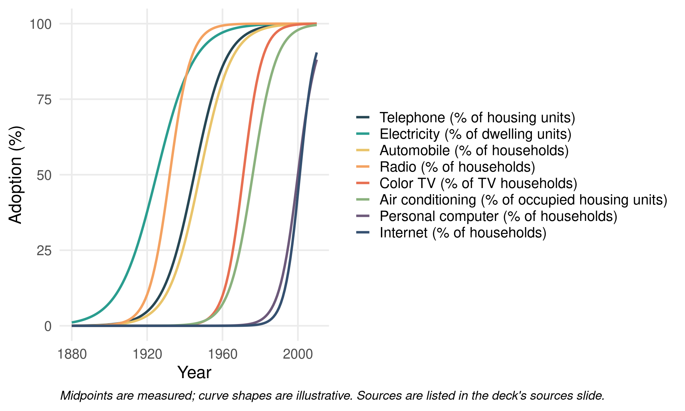

```{r setup, include=FALSE}
library(ggplot2)

# S-curve from a logistic function, as in the textbook chapter
```

## What Is Diffusion?

Diffusion is the spread of objects, ideas, information, concepts, fashions, tastes, or practices within a social network.

The process has five components:

- **Innovation**: the object that diffuses
- **Actors**: the people or groups that adopt, or fail to adopt, the innovation
- **Flow**: movement of the innovation from a source actor to an adopting actor
- **Mechanism**: the process linking sources and adopters, such as imitation, contact, proximity, influence, or comparison
- **Outcome**: the end state of the adopter, such as opinion change, conversion, participation, or infection

## Why Do Things Diffuse?

Three factors account for why some things spread and others do not.

- **The object**: familiar, low-risk innovations with a favorable cost-benefit ratio diffuse more easily
- **The source and adopter**: people adopt from high-status sources, or from those they see as similar to themselves
- **The environment**: geographic or social proximity, shared social foci such as workplaces or clubs, and overall network structure

## Four Network Models of Diffusion

- **Direct cohesion**: the connectivity of adopters to their sources through network ties
- **Two-step**: the social distance between adopters and influential sources, and the traits of those influentials
- **Threshold**: the susceptibility of adopters to the behavior of multiple sources
- **Positional equivalence**: indirect influence and comparison between sources and structurally similar adopters

## Diffusion via Cohesion

- The simplest model: innovations "travel" along direct network links
- The main mechanism is imitation, often driven by the **similarity heuristic**: "I adopt the innovations that people like me adopt" (homophily)
- A second mechanism is **contagion**, where an innovation spreads like a virus, so more direct connections to adopters raise the chance of adopting

## The Medical Innovation Study

Coleman, Katz, and Menzel (1957) followed doctors' adoption of a new drug over about 15 months in four cities.

- The team mapped advice and discussion ties among doctors, and merged them with prescription records that fixed each doctor's first prescription month
- **Months 1–2**: professional advice and discussion ties were most effective
- **Months 3–4**: friendship ties took over
- **Months 4–5**: the network reached less integrated, "isolated" doctors
- **Months 6 and later**: the network was exhausted, and late adopters relied on ads and salesmen instead

## Two-Step Models

- Innovations reach **opinion leaders** first, and potential adopters then look to them for what to adopt
- Opinion leaders are visible, well-connected early adopters, such as celebrities or social media influencers
- Network terms for leaders: high degree (popular), high eigenvector centrality (connected to popular people), or high betweenness (bridging groups)
- The two-step model can combine with cohesion: leaders receive the innovation from a source, and then it spreads among adopters through their ties

## Diffusion via Positional Equivalence

- Cohesion models assume influence flows only between connected actors
- Diffusion can also operate between disconnected actors who occupy similar structural positions
- The mechanism is **comparison**: people adopt to keep their status or competitiveness relative to similarly positioned others

## The S-Curve

Cumulative adoptions typically follow an S-shaped pattern with three phases:

- **Initial slow uptake**: early adopters and innovators take up the innovation while most of the population waits
- **Rapid spread**: adoption accelerates, and the number of new adopters per unit time peaks during the "take off" period
- **Final slow saturation**: adoption levels off as most potential adopters have joined

## The S-Curve Shape

{width="880px"}

## Sources for the S-Curve Figure

| Technology | Midpoint | Measured points |
|:--|:-:|:--|
| Telephone | 1945 | 36.9% (1940), 61.8% (1950), Census |
| Electricity | 1925 | 34.7% (1920), 68.2% (1930), Census |
| Automobile | 1948 | 50% (1948) |
| Radio | 1932 | 40% (1930), 60% (1934) |
| Color TV | 1971 | 48% (1971), 50%+ (1972) |
| Air conditioning | 1976 | 35.8% (1970), 58.5% (1980) |
| Personal computer | 2000 | 51% (2000, CPS) |
| Internet | 2001 | 50.4% (2001, CPS) |

Denominators are in the figure legend. Cellphone is omitted: the Pew series starts at 62% of adults in 2002.

## The Tipping Point

- The tipping point comes after early adopters and before the early majority fully engage
- Innovations that never reach it often die out
- Many historical innovations, from electricity to the VCR to the internet, follow the S-shaped pattern
- Social movements can show a long uptake period followed by rapid mobilization

## Global Threshold Model

Granovetter and Soong (1983) proposed that each person has a threshold $q(i)$, with $0 < q(i) < 1$.

- Person $i$ adopts when the proportion of people who have adopted, $p$, reaches $q(i)$
- A person with $q = 0.25$ adopts once a quarter of the population has adopted; one with $q = 0.75$ waits until three quarters have
- The model assumes everyone knows the population-wide adoption rate, which fits public, observable behaviors

## Thresholds Explain the S-Curve

- **Slow start**: only people with very low thresholds adopt
- **Rapid spread**: when thresholds cluster in the middle, the majority joins
- **Slow finish**: only people with high thresholds remain

The shape of the threshold distribution matters. A distribution skewed toward risk-averse late adopters makes full diffusion less likely. One with plenty of high-risk early adopters makes it more likely.

## Rogers's Classification of Adopters

Rogers (1962) groups adopters by their time of adoption relative to the average.

| Category | Share of adopters | Timing |
|:--|:-:|:--|
| Innovators | 2.5% | More than 1 SD before average |
| Early adopters | 13.5% | More than 1 SD before average |
| Early majority | 34% | Within 1 SD before average |
| Late majority | 34% | Within 1 SD after average |
| Laggards | 16% | More than 1 SD after average |

Early adopters are the opinion leaders who influence the early majority. Failed innovations die before reaching the tipping point.

## Valente's Network Threshold Model

- Granovetter's model assumes global knowledge; Valente's model uses each person's **local** network
- Each person has an exposure $e(i)$, the proportion of their friends who have adopted
- A person adopts when $e(i)$ reaches their personal threshold $q(i)$
- In the textbook example, a person with $q = 0.25$ adopts after one of three friends does, while a person with $q = 0.75$ waits until three of four friends have adopted

## Valente's Four Types of Adopters

Two thresholds, personal and whole-network, yield four types:

- **True innovators** (influentials): low personal and low whole-network thresholds
- **Isolates**: low personal threshold, high whole-network threshold
- **Connected bandwagon**: high personal threshold, low whole-network threshold
- **Resistant rearguard**: high personal and high whole-network thresholds, largely matching Rogers's laggards

Adopter categories can also be relative. You can be an innovator in the system and a laggard among your friends, or the reverse.

## Local and Cosmopolitan Diffusion

- Cosmopolitan innovators tend to be early adopters relative to the system, with low thresholds relative to their own network
- They often adopt through media or weak ties
- Late adopters often rely on friends and strong ties

## Simplex and Complex Contagion

| Feature | Simplex | Complex |
|:--|:--|:--|
| Threshold | Low; one exposure often enough | High; multiple sources needed |
| Risk or cost | Low | High; risk, ostracism, or resource loss |
| Primary ties | Weak ties (bridges) | Strong ties (cliques) |
| Information | Simple, novel | Complex, interdependent |

Information, gossip, and disease are candidates for simplex contagion. Social movement participation, religious conversion, and migration are candidates for complex contagion.

## Which Ties Speed Diffusion?

- Simplex contagion can spread faster through weak ties, which bridge otherwise separate parts of a network (Granovetter 1973)
- Complex contagion can spread faster through cliques and strong ties, because it needs repeated reinforcement
- Weak ties carry an innovation across a bridge only once, so they often fail to supply the multiple exposures complex contagion requires

## Key Takeaways

- Diffusion follows an S-shaped path, with slow uptake, rapid spread, and saturation
- Direct cohesion, two-step, threshold, and positional models each explain a different part of that path
- Whether an innovation spreads through weak bridges or strong cliques depends on whether it is simple or complex to adopt
- Local networks can explain adoption patterns that global models cannot
