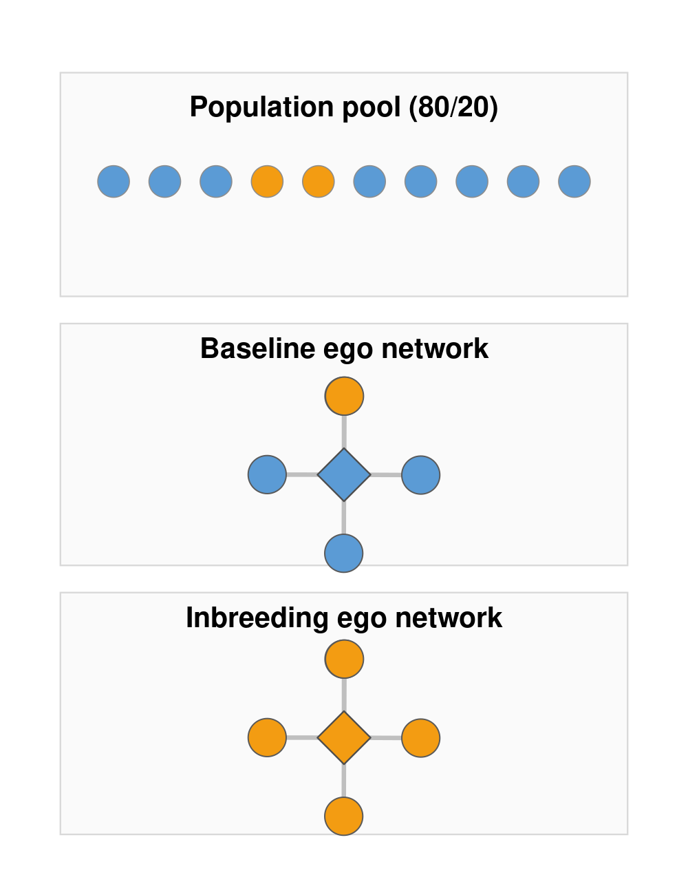
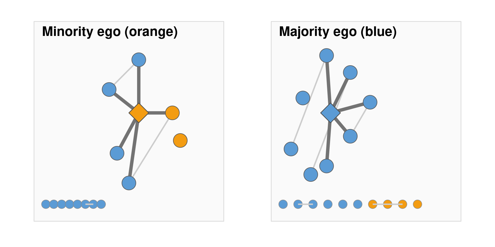
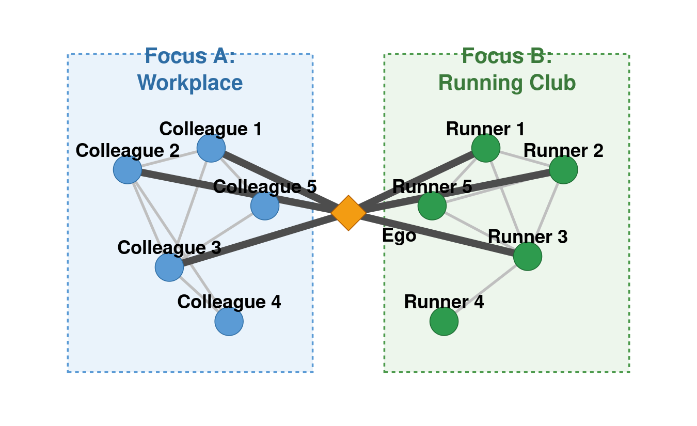
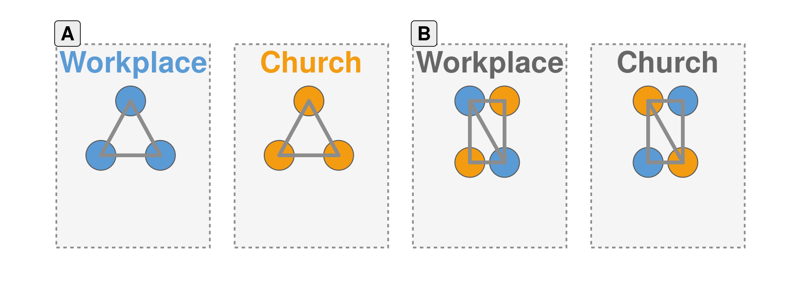
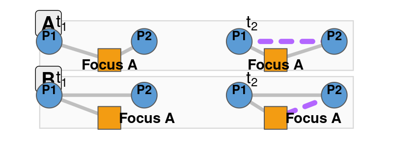
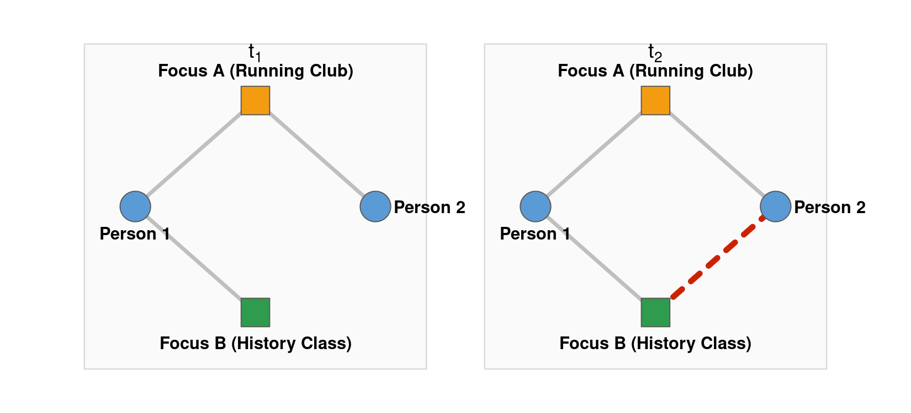
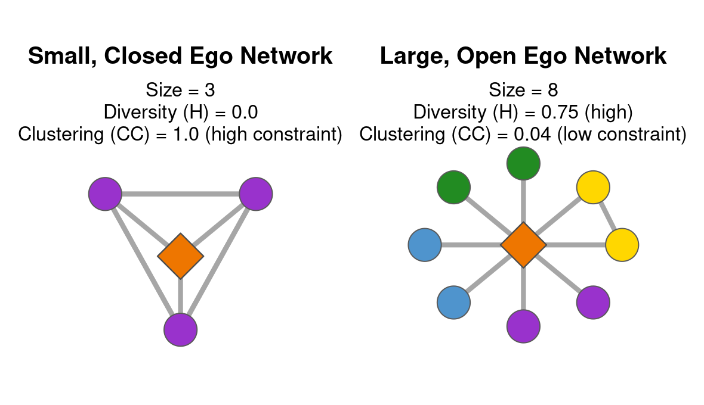
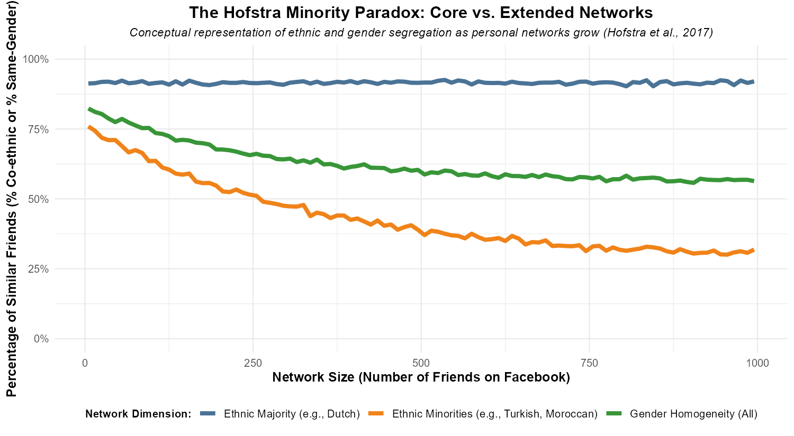

```{r setup, include=FALSE}
library(ggplot2)
library(ggraph)
library(tidygraph)
library(patchwork)

# Blau: heterogeneity (nominal parameters) vs inequality (graduated parameters)
df_a <- data.frame(
  grp = factor(rep(c("G1", "G2", "G3", "G4"), 2), levels = c("G1", "G2", "G3", "G4")),
  share = c(25, 25, 25, 25, 85, 5, 5, 5),
  soc = rep(c("Heterogeneous", "Homogeneous"), each = 4)
)
p_blau_a <- ggplot(df_a, aes(y = soc, x = share, fill = grp)) +
  geom_col(width = 0.55) +
  annotate("text", x = 57, y = 2, label = "one group: 85%", size = 5.2, fontface = "bold", color = "white") +
  scale_fill_brewer(palette = "Set2") +
  scale_x_continuous(limits = c(0, 103)) +
  labs(title = "Nominal (race)", x = "Share of population (%)", y = NULL) +
  theme_minimal(base_size = 16) +
  theme(plot.title = element_text(face = "bold", hjust = 0.5, size = 16), legend.position = "none",
        plot.margin = margin(2, 2, 2, 2), axis.text.y = element_text(face = "bold", size = 15),
        axis.title.x = element_text(size = 15))

p_blau_b <- ggplot(data.frame(x = c(0, 1)), aes(x)) +
  stat_function(fun = dnorm, args = list(mean = 0.5, sd = 0.16), color = "steelblue", linewidth = 1.6) +
  stat_function(fun = function(x) 1.45 * dgamma(x, shape = 2, rate = 5), color = "firebrick", linewidth = 1.6) +
  annotate("text", x = 0.98, y = 2.85, label = "egalitarian", color = "steelblue", hjust = 1, size = 5.8, fontface = "bold") +
  annotate("text", x = 0.98, y = 2.45, label = "concentrated", color = "firebrick", hjust = 1, size = 5.8, fontface = "bold") +
  scale_y_continuous(limits = c(0, 3.1)) +
  labs(title = "Graduated (income)", x = NULL, y = NULL) +
  theme_minimal(base_size = 16) +
  theme(plot.title = element_text(face = "bold", hjust = 0.5, size = 16),
        axis.text = element_blank(), axis.ticks = element_blank(),
        plot.margin = margin(2, 2, 2, 2))
p_blau <- p_blau_a / p_blau_b

# Blau Rule 3: correlated parameters (stylized illustrations)
df_cc <- expand.grid(race = c("Race A", "Race B"), rel = c("Religion 1", "Religion 2"))
df_cc$val <- c(0.70, 0.10, 0.05, 0.15)
p_cc <- ggplot(df_cc, aes(x = rel, y = race, fill = val)) +
  geom_tile(color = "white", linewidth = 1.5) +
  geom_text(aes(label = paste0(round(100 * val), "%")), size = 4.2, fontface = "bold") +
  scale_fill_gradient(low = "grey95", high = "steelblue", guide = "none") +
  labs(title = "Race × Religion", x = "Religion", y = "Race") +
  theme_minimal(base_size = 13) +
  theme(plot.title = element_text(face = "bold", hjust = 0.5))

set.seed(2026)
df_cg <- data.frame(income = c(rnorm(50, 40, 7), rnorm(50, 72, 9)),
                    grp = rep(c("Race A", "Race B"), each = 50))
p_cg <- ggplot(df_cg, aes(x = grp, y = income, color = grp)) +
  geom_jitter(size = 1.7, alpha = 0.55, width = 0.18, show.legend = FALSE) +
  scale_color_manual(values = c("Race A" = "steelblue", "Race B" = "firebrick")) +
  labs(title = "Race × Income", x = NULL, y = "Income") +
  theme_minimal(base_size = 13) +
  theme(plot.title = element_text(face = "bold", hjust = 0.5),
        axis.text.x = element_text(face = "bold"))

df_kk <- data.frame(age = 20:80)
df_kk$wealth <- 0.9 * (df_kk$age - 18)^1.8 / 10 + rnorm(61, 0, 4)
p_kk <- ggplot(df_kk, aes(x = age, y = wealth)) +
  geom_point(size = 1.7, color = "forestgreen", alpha = 0.7) +
  geom_smooth(se = FALSE, color = "grey30", linewidth = 1) +
  labs(title = "Age × Wealth", x = "Age", y = "Wealth") +
  theme_minimal(base_size = 13) +
  theme(plot.title = element_text(face = "bold", hjust = 0.5))
p_rule3 <- p_cc | p_cg | p_kk

# Foci continuum: tie generators <-> taste diffusers
p_foci_spec <- ggplot(data.frame(x = 0:1), aes(x)) +
  annotate("segment", x = 0.02, xend = 0.98, y = 0, yend = 0,
           arrow = arrow(length = unit(5, 'mm')), linewidth = 2.2, color = "grey45") +
  annotate("point", x = c(0.12, 0.5, 0.88), y = 0, size = 10,
           color = c("steelblue", "darkorchid", "forestgreen")) +
  annotate("text", x = c(0.12, 0.5, 0.88), y = 0.3,
           label = c("Student clubs:\ntie generators", "Majors & activities:\nboth roles", "Musical genres:\ntaste diffusers"),
           size = 4.8, fontface = "bold", lineheight = 0.95,
           color = c("steelblue", "darkorchid", "forestgreen")) +
  annotate("text", x = c(0.02, 0.98), y = -0.32,
           label = c("Concrete sites of activity\n(high barriers, high interaction)",
                     "Broad cultural structures\n(low barriers, easy adoption)"),
           size = 4.8, hjust = c(0, 1), lineheight = 0.95) +
  scale_y_continuous(limits = c(-0.55, 0.6), breaks = NULL, labels = NULL) +
  scale_x_continuous(limits = c(0, 1), breaks = NULL, labels = NULL) +
  theme_minimal(base_size = 14) +
  theme(panel.grid = element_blank(), axis.text = element_blank(),
        axis.title = element_blank(), axis.ticks = element_blank())

# Hofstra: small dense core vs large sparse extended network
make_net <- function(n_alt, dense, title) {
  al <- paste0("a", 1:n_alt)
  edges_n <- data.frame(from = rep("Ego", n_alt), to = al)
  if (dense) {
    pr <- combn(al, 2, simplify = FALSE)
    edges_n <- rbind(edges_n, data.frame(from = sapply(pr, `[`, 1), to = sapply(pr, `[`, 2)))
  }
  nm <- c("Ego", al)
  g_n <- tbl_graph(nodes = data.frame(name = nm, role = ifelse(nm == "Ego", "Ego", "Alter")),
                   edges = edges_n, directed = FALSE)
  ang <- (0:(n_alt - 1)) * 2 * pi / n_alt
  l_n <- rbind(c(0, 0), cbind(cos(ang), sin(ang)))
  ggraph(g_n, layout = "manual", x = l_n[,1], y = l_n[,2]) +
    geom_edge_link(color = "grey70", width = 1.1) +
    geom_node_point(aes(color = role), size = 11, show.legend = FALSE) +
    geom_node_text(aes(label = ifelse(role == "Ego", "Ego", "")), vjust = 2.2, size = 7, fontface = "bold", color = "grey25") +
    labs(title = title) +
    theme_graph() +
    coord_cartesian(xlim = c(-1.35, 1.35), ylim = c(-1.35, 1.35), clip = "off") +
    theme(plot.title = element_text(hjust = 0.5, face = "bold", size = 13),
          plot.margin = margin(2, 2, 2, 2)) +
    scale_color_manual(values = c(Ego = "firebrick", Alter = "tan2"))
}
p_hofs <- make_net(5, TRUE, "Small core network") + make_net(9, FALSE, "Large extended network")
```

## The Puzzle of Homogeneity and Diversity

- **The Homophily Propensity**:
  - In everyday social life, "birds of a feather flock together."
  - People tend to form relationships with others who share similar traits (gender, race, class, age, religion).

- **The Core Analytical Question**:
  - Why are ego networks homogeneous or diverse?
  - **Individualist/Selection Explanation**: People have psychological preferences for similarity, choosing similar alters (**choice homophily**).
  - **Structuralist/Constraint Explanation**: Broad social forces and contexts structure opportunity, sorting people so they can only meet similar others (**induced homophily**).

- **Structural Sources**:
  - We examine how society's macro-demographic layout (Blau), organizational settings (Feld), and network size constraints (Marsden) shape homogeneity and diversity independent of individual preferences.

---

## McPherson's Classic Homophily Framework

- **Defining Homophily**:
  - McPherson, Smith-Lovin, and Cook (2001) define **homophily** as the principle that contact between similar people occurs at a higher rate than among dissimilar people.
  - It is the primary structural property of human social networks, creating a highly segmented social world.

- **The Baseline vs. Inbreeding Distinction**:
  - To study homophily scientifically, McPherson et al. split the phenomenon into two types:
  - **1. Baseline Homophily**: The demographic opportunity structure. It is the expected level of similarity if ties were formed completely at random within the pool of available potential partners.
  - **2. Inbreeding Homophily**: Active selection. It is the level of similarity formed *over and above* the baseline demographic opportunity (driven by choice, cultural tastes, or systemic bias).

---

## Visualizing Baseline vs. Inbreeding Homophily

::: {.columns}
::: {.column width="45%"}
- **How Population Structure Shapes Bias**:
  - **Population Pool**: Determines the base statistical probability of contact.
  - **Unbiased Network (Baseline)**: An orange minority member has an ego network that matches the 80/20 population distribution (4 Blue, 1 Orange). 
  - **Highly Biased Network (Inbreeding)**: Overriding population constraints, the minority member associates exclusively with orange alters (0 Blue, 5 Orange).
  - *Takeaway*: A network is only "biased" if its homogeneity exceeds the baseline population pool.
:::

::: {.column width="55%"}
{fig-align="center" width="425px"}
:::
:::

---

## McPherson's Sources and Dimensions of Homophily

- **The Major Dimensions of Homophily**:
  - **Race and Ethnicity**: The strongest and most persistent social split in personal networks.
  - **Other Key Dimensions**: Gender, age, religion, education, occupation, and social class.

- **The Five Structural Sources of Homophily**:
  - **1. Geography**: Spatial distance heavily restricts face-to-face encounters.
  - **2. Family**: Kinship ties are naturally locked-in and highly homophilous on race and class.
  - **3. Organizational Foci**: School, work, and associations sort similar people together (Feld's foci).
  - **4. Isomorphic Positions**: People occupying similar social roles (e.g., professions) develop similar habits, activities, and schedules.
  - **5. Cognitive Ease**: Communication with similar others requires less mental effort, reducing friction and coordination costs.

---

## Blau's Macrostructural Theory: Parameters

::: {.columns}
::: {.column width="46%"}
- **Social structure as distribution**: Blau (1977) defines social structure as the *distribution* of people across **social positions**. These distributions determine who has the *opportunity* to meet whom.

- **Nominal parameters**: categorical attributes with no rank order (gender, race, religion, nationality). Their distribution is **heterogeneity**.

- **Graduated parameters**: rank-ordered attributes (age, education, income, wealth). Their distribution is **inequality**.
:::

::: {.column width="54%"}
```{r}
#| echo: false
#| fig-width: 5.7
#| fig-height: 4.5
p_blau
```
:::
:::

---

## Blau's Group Size Effects (Rules 1 & 2)

- Broad demographic proportions determine the statistical probability of meeting ingroup versus outgroup members, heavily biasing ego networks.

- **Rule 1: Smaller Groups and Outgroup Ties**
  - *Members of numerically smaller groups (minorities) are proportionally more likely to form ties with individuals outside their own group (outgroup members).*
  - This follows from the arithmetic of opportunity alone: because the pool of available ingroup partners is small, encounters with outgroup members are proportionally more likely.
  - Minorities naturally experience greater social diversity in their personal networks.

- **Rule 2: Larger Groups and Ingroup Ties**
  - *Members of numerically larger groups (majorities) are proportionally more likely to form ties within their own group (ingroup members), regardless of choice.*
  - When a group dominates numerically, its members have almost exclusively ingroup ties, because the probability of meeting an outgroup member is statistically negligible.

---

## Visualizing Blau's Group Size Effects

{fig-align="center" width="85%"}

---

## Blau's Multiform Heterogeneity (Rule 3)

- **Rule 3: Correlated dimensions of association**: macro structures rarely have independent parameters; dimensions of social differentiation are systematically correlated (race with religion, race with income, age with wealth).

- **Propagated bias**: a network biased on one parameter is automatically biased on every correlated parameter — even if ego is entirely neutral about the second. Observed homogeneity often reflects a societal correlation, not a personal choice.

```{r}
#| echo: false
#| fig-width: 9.4
#| fig-height: 3.1
p_rule3
```

*Left to right: categorical × categorical, categorical × graduated, graduated × graduated.*

---

## Feld's Theory of Social Foci

- **Context-Driven Link Formation**:
  - Scott Feld (1981) posits that social ties do not form in a vacuum or solely from abstract preferences. They emerge from specific social contexts.
  - **Social Focus**: *Any social, psychological, legal, or physical entity around which joint activities are organized* (e.g., workplaces, student clubs, voluntary groups, neighborhood hangouts, families).

- **Mechanisms of Tie Formation**:
  - **From circle to relation**: Being sorted into the same social circle/group makes individuals highly likely to form interpersonal ties.
  - **From common activity to relation**: Shared activities in a focus increase interaction frequency, facilitating connection.

- **Tie Maintenance**:
  - Foci create supportive environments. Ties embedded within highly constraining foci are much more likely to persist over time, even if individual sentiment or liking declines.

---

## Dimensions of Social Foci and Structural Effects

::: {.columns}
::: {.column width="45%"}
- **Two Key Dimensions of Foci**:
  - **Size**: The number of people involved. Large foci (universities) offer diverse pools; small foci (nuclear family) force intimate interaction.
  - **Constraint**: The time and energy a focus demands. Constraining foci (full-time job, military squad) limit contact with outsiders, leading to homogeneous networks.

- **Cross-Cutting Circles**:
  - Individuals belong to multiple intersecting foci.
  - Overlapping memberships assemble diverse alters — local clustering plus bridging opportunities.
:::

::: {.column width="55%"}
{fig-align="center" width="650px"}
:::
:::

---

## Feld's Rule: How Segregated Foci Drive Homogeneity

::: {.columns}
::: {.column width="45%"}
- **How Context Shapes Diversity (Feld, 1982)**:
  - Feld's Rule states that segregated networks can arise solely from how social foci are organized, *independent* of personal choice or group size.
  - **Panel A: Segregated Foci**: Workplace is 100% Blue; Church is 100% Orange. Egos in each focus form completely homogeneous networks.
  - **Panel B: Integrated Foci**: Both settings are diverse (50/50). Egos in either focus naturally develop diverse personal networks.
  - *Takeaway*: The exact same (neutral) preferences lead to highly segregated or diverse networks depending on context diversity.
:::

::: {.column width="55%"}
{fig-align="center" width="660px"}
:::
:::

---

## Dynamic Focus Theory: Tie Generators vs. Taste Diffusers

- **Beyond Static Foci**:
  - Scott Feld's classic theory is a "one-way comparative static": joint membership in a focus exogenously drives friendship formation (**Tie Generation**).
  - Hachen, Wang, Sepulvado, and Lizardo (2024) introduce **Dynamic Focus Theory**, treating interpersonal relationships and context affiliations as a two-way, co-evolving system.

- **The Dual Pathways of Co-Evolution**:
  - **1. Tie Formation via Joint Affiliation** (Foci as *Tie Generators*): People join the same focus first (e.g., a student club), and this shared context subsequently generates an interpersonal friendship.
  - **2. Foci Affiliation via Social Ties** (Foci as *Taste Diffusers*): People are friends first, and one friend subsequently recruits or pulls the other into joining their focus (e.g., adopting a music taste).

---

## The Foci Continuum: Cultural Structures vs. Sites of Activity

- Foci differ in **physical boundedness, entry barriers, and interaction costs** (Hachen et al., 2024) — and that determines what they do to networks.

- **Concrete sites** (student clubs): high face-to-face interaction, high entry barriers — excellent **tie generators**, but hard for friends to recruit each other into.

- **Broad cultural structures** (musical genres): unbounded, low barriers — poor tie generators, but excellent **taste diffusers** through existing friends.

- **Hybrid foci** (course areas, activities): concrete workspaces *and* shared cultural preferences — both roles at once.

```{r}
#| echo: false
#| fig-width: 9.4
#| fig-height: 2.6
p_foci_spec
```

---

## Visualizing Dynamic Foci Processes

::: {.columns}
::: {.column width="45%"}
- **How Coupled Networks Co-Evolve**:
  - **Panel A: Tie Generation (Classic Focus Effect)**:
    - Time 1: Person 1 and Person 2 both belong to Focus A.
    - Time 2: The shared context brings them together, and a new tie forms.
  - **Panel B: Taste Diffusion (Dynamic Focus Effect)**:
    - Time 1: Person 1 belongs to Focus A and is friends with Person 2.
    - Time 2: Social influence or peer recruitment leads Person 2 to also adopt Focus A.
- **Key Lesson**: Foci are both *conduits for friendship* and *items of taste* that diffuse through those friendships.
:::

::: {.column width="55%"}
{fig-align="center" width="560px"}
:::
:::

---

## Hachen et al.'s Concept of 'Indirect Contagion'

::: {.columns}
::: {.column width="45%"}
- **Contagion without Friendship**:
  - Hachen et al. (2024) uncovered **Positive Affiliation Contagion** (the "4-cycle" effect).
  - People in the same focus (co-members) tend to adopt each other's *other* affiliations **without sharing any direct friendship tie**.

- **Why It Happens (Three Drivers)**:
  - **1. Institutional Linkages**: Organizations are naturally linked (departments share advisors and buildings, guiding students across foci).
  - **2. Context Mapping**: People observe what co-members do, then independently copy their behaviors and tastes.
  - **3. Structural Pairing**: Some lifestyles or tastes naturally pair (country music and bluegrass).
:::

::: {.column width="55%"}
{fig-align="center" width="650px"}
:::
:::

---

## Marsden's Theory of Ego Network Diversity

- Peter Marsden (1987) utilized the 1985 General Social Survey (GSS)—which used name generators to measure **core discussion networks** ("discuss matters important to you")—to uncover fundamental structural rules of personal networks.

- **The Size-Diversity-Clustering Trade-off**:
  - Network structural features constrain and shape diversity and homophily.

- **1. Network Size and Diversity (Marsden's Rule)**:
  - **Larger ego networks** tend to be more diverse, less homophilous, and less constrained (less clustered/dense; alters are less likely to know one another).
  - As an individual expands network size, they are mathematically forced to move beyond their closest, most similar circles, encountering different types of people.
  - **Smaller ego networks** tend to be highly clustered, less diverse, and highly homophilous (usually centered on close family or core friends).

---

## Marsden's Rule, Tie Strength, and Kinship

::: {.columns}
::: {.column width="45%"}
- **2. The Role of Tie Strength**:
  - Ego networks with high average **tie strength** tend to exhibit high clustering but low diversity.
  - Strong ties imply shared context and mutual dependencies, leading to network closure and homogeneity.

- **3. Kinship Density**:
  - A higher proportion of **kin (relatives)** in an ego network leads to:
    - Greater clustering (relatives almost all know one another).
    - Greater homophily and lower overall socio-demographic diversity.
    - *Note*: Kinship ties represent structurally locked-in relationships that strongly resist dilution.
:::

::: {.column width="55%"}
{fig-align="center" width="560px"}

*As network size increases, diversity rises, homophily decreases, and density/clustering drops.*
:::
:::

---

## Testing Theories in the Digital Era: The Hofstra Facebook Study

::: {.columns}
::: {.column width="55%"}
- **Setting**: the Facebook networks of Dutch adolescents (Hofstra, Corten, van Tubergen, & Ellison, 2017; $N = 2{,}810$, ~1.1 million ties), comparing small **core** (strong-tie) with larger **extended** (weak-tie) networks.

- **Question**: do the classic offline rules of opportunity (Blau) and context (Feld) still govern friendship in a seemingly unbounded online world?

- **Findings**: online networks are far more **ethnically** segregated than **gender** segregated — gender is a 50/50 population split, ethnic group sizes are not — and classroom and school composition (Feld's foci) directly predicts online segregation.
:::

::: {.column width="45%"}
```{r}
#| echo: false
#| fig-width: 5.2
#| fig-height: 2.8
p_hofs
```

*Schematic networks: a dense five-alter core and a sparse nine-alter extended network. They illustrate the contrast, not the study's data.*
:::
:::

---

## Connecting Hofstra to Blau & Marsden: Core Concepts

- **The Theoretical Interplay**:
  - Hofstra et al. (2017) explored how population size (Blau) and network size (Marsden) jointly dictate segregation.
  - **Marsden's Rule**: Expanding network size should naturally dilute homophily, making networks more diverse.
  - **Blau's Group Size Effect**: Majorities are surrounded by co-ethnics, while minorities face limited ingroup partners.
  - **The Question**: Does growing your network always increase diversity, or does your group's size override this effect?

---

## Hofstra's Findings: The Minority Paradox

::: {.columns}
::: {.column style="width: 48%;"}
- **For Ethnic Minorities**:
  - **Marsden's rule holds**. As their Facebook network grows, their co-ethnic friend percentage **drops significantly** (orange curve).
  - *Why?* They quickly "run out" of co-ethnic alters, forcing bridges to other groups.

- **For the Ethnic Majority**:
  - **Marsden's rule is violated!** As their network grows, co-ethnic share **stays flat near 91%** (blue line).
  - *Why?* Majority members are so plentiful they never run out of co-ethnics.

- **Gender Baseline**:
  - For both boys and girls, expanding networks dilutes gender homogeneity toward the 50% baseline (green curve).
:::

::: {.column style="width: 52%;"}
{fig-align="center" width="650px"}

*Pattern after Hofstra et al. (2017).*
:::
:::

---

## Synthesis: Structural Sources of Ego Network Composition

The composition of your personal network is heavily structured for you by forces beyond your direct control:

::: {style="font-size: 0.55em;"}
| Theorist | Core Source of Network Layout | Key Dynamic / Findings |
|---|---|---|
| **Miller McPherson** | Multidimensional social space and opportunity structures. | Distinguishes baseline (demographic pools) from inbreeding (choice) homophily. |
| **Peter Blau** | Macro-demographic proportions & societal parameter correlations. | Group sizes dictate outgroup probabilities. Biases propagate via parameter correlations. |
| **Scott Feld** | Organizational contexts, physical entities, and joint activities (foci). | Co-membership drives tie formation; focus constraint determines tie maintenance. |
| **David Hachen et al.** | Co-evolving coupled network ecology (one-mode & two-mode). | Classifies contexts as Tie Generators (clubs), Taste Diffusers (music), or hybrids. |
| **Peter Marsden** | Structural features, network size, and tie properties. | Expanding network size mathematically dilutes homophily and clustering. |
:::

- **Takeaway**: Network scholars must control for macro-opportunities, organizational sorting, and size constraints before attributing network homogeneity to individual choice.

---

## Active Learning: Concept Check!

- **Review Question**:
  - Suppose a university establishes a new compulsory **First-Year Seminar Program** where students are randomly assigned to small, 15-student discussion cohorts that meet weekly. 
  - Over the school year, dense friendship circles form within these cohorts. In some cohorts, students also begin sharing and adopting each other's music and fashion preferences.

- **Class Discussion Questions**:
  - **1. Context-Driven Tie Generation**: Which of **Feld's** social foci dimensions explain the dense friendship circles?
  - **2. Co-Evolution of Context and Tastes**: According to **the Dynamic Focus Theory of Hachen and Collaborators** dynamic foci framework, how do we distinguish whether these cohorts acted as *Tie Generators* or *Taste Diffusers*? What observable network sequences would support each pathway?
  - **3. Network Spillover**: If a student in Seminar A begins attending another student's separate campus group without any friendship ties, what dynamic focus process does this represent?
  - **4. Opportunity Restrictions**: How would **Blau's** rules of relative group size and **Marsden's** size-diversity rule predict the demographic composition of these student friendship circles?
