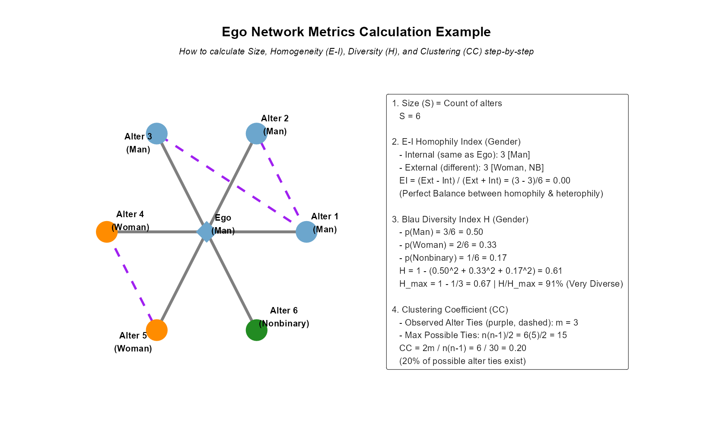

```{r setup, include=FALSE}
library(ggplot2)
library(ggraph)
library(tidygraph)

# Same network as the E-I example: ego is a man; alters 1-3 are men, 4-5 women, 6 nonbinary
ex_pos <- rbind(c(0, 0), cbind(cos((0:5) * pi / 3), sin((0:5) * pi / 3)))
ex_graph <- tbl_graph(
  nodes = data.frame(
    label = c("Ego", as.character(1:6)),
    role = c("Ego", "Man", "Man", "Man", "Woman", "Woman", "Nonbinary")
  ),
  edges = data.frame(
    from = c(rep(1, 6), 2, 2, 5),
    to   = c(2:7, 3, 4, 6),
    tie  = c(rep("ego", 6), rep("alter", 3))
  ),
  directed = FALSE
)

ex_role_plot <- function() {
  ggraph(ex_graph, layout = "manual", x = ex_pos[, 1], y = ex_pos[, 2]) +
    geom_edge_link(color = "grey70", width = 1.2) +
    geom_node_point(aes(color = role), size = 14) +
    geom_node_text(aes(label = label), color = "white", fontface = "bold", size = 6) +
    scale_color_manual(values = c(Ego = "grey30", Man = "steelblue",
                                  Woman = "darkorange", Nonbinary = "forestgreen"),
                       name = NULL) +
    coord_fixed(xlim = c(-1.45, 1.45), ylim = c(-1.45, 1.45), clip = "off") +
    theme_graph() +
    theme(legend.position = "bottom", legend.text = element_text(size = 10))
}

ex_tie_plot <- function() {
  ggraph(ex_graph, layout = "manual", x = ex_pos[, 1], y = ex_pos[, 2]) +
    geom_edge_link(aes(color = tie, linetype = tie), width = 1.4) +
    scale_edge_color_manual(values = c(ego = "grey75", alter = "darkorchid"), guide = "none") +
    scale_edge_linetype_manual(values = c(ego = "solid", alter = "dashed"), guide = "none") +
    geom_node_point(aes(color = label == "Ego"), size = 14, show.legend = FALSE) +
    geom_node_text(aes(label = label), color = "white", fontface = "bold", size = 6) +
    scale_color_manual(values = c("TRUE" = "grey30", "FALSE" = "steelblue")) +
    coord_fixed(xlim = c(-1.45, 1.45), ylim = c(-1.45, 1.45), clip = "off") +
    theme_graph()
}
```

## Key Ego Network Metrics: Size and Homogeneity

Researchers compute specific structural properties from ego-alter attributes and alter-alter connections.

- **1. Ego Network Size ($S(Ego)$)**:
  - A count of the ego-to-alter ties ($E_{ea}$), equivalent to ego's degree ($k^{Ego}$).
  - $$S(Ego) = |N(Ego)| = |E_{ea}|$$

- **2. E-I Homophily Index (Krackhardt & Stern, 1988)**:
  - Measures in-group and out-group preference based on categorical attributes of ego and alters.
  - $$EI = \frac{External - Internal}{External + Internal}$$
  - **Internal Ties (Int)**: Ties to alters who share the exact same category as Ego.
  - **External Ties (Ext)**: Ties to alters in categories different from Ego.
  - **Range**: $[-1.0, +1.0]$ — $-1.0$ = complete homophily; $+1.0$ = complete heterophily; $0.0$ = perfect balance.

---

## Step-by-Step Metrics Calculation Example

::: {.columns}
::: {.column width="45%"}
<div style="font-size: 90%;">

- **Worked example** (network at right):
  - **Ego**: Man (Blue)
  - **Alters**: 3 Men (Blue), 2 Women (Orange), 1 Nonbinary (Green).

- **1. Size ($S$)**:
  - $S = 6$ alters.

- **2. E-I Homophily Index (Gender)**:
  - Internal ($Int$) = 3 (Alters 1, 2, 3 are Men, same as Ego)
  - External ($Ext$) = 3 (Alters 4, 5 are Women; Alter 6 is Nonbinary)
  - $$EI = \frac{3 - 3}{3 + 3} = \frac{0}{6} = 0.00$$
  - Perfect balance: no structural ingroup or outgroup bias.

</div>
:::

::: {.column width="55%"}
{fig-align="center" width="650px"}
:::
:::

---

## Key Ego Network Metrics: Diversity (Blau's Index)

- **3. Blau's Heterogeneity Index ($H$)**:
  - Measures overall sociodemographic diversity among alters. Crucially, **Ego's own attribute does not matter**.
  - $$H = 1 - \sum_{k} p_k^2$$
  - Where $p_k$ is the proportion of alters belonging to category $k$.
  - **Range**: $[0.0, H_{max}]$
    - **0.0**: No diversity (all alters belong to a single category).
    - **Maximum Diversity ($H_{max}$)**: Occurs when categories are equally represented:
    - $$H_{max} = 1 - \frac{1}{k}$$
    - Where $k$ is the number of available categories.

---

## Worked Example: Blau's Diversity Index

::: {.columns}
::: {.column width="45%"}
- **Proportions**: $p_{man} = 3/6 = 0.500$, $p_{woman} = 2/6 = 0.333$, $p_{nonbinary} = 1/6 = 0.167$.
- **Sum of squares**: $0.250 + 0.111 + 0.028 = 0.389$.
- **Maximum**: with $k = 3$ categories, $H_{max} = 1 - 1/3 = 0.667$.
- Ego's own gender does not enter the calculation.
:::

::: {.column width="55%"}
```{r}
#| echo: false
#| fig-width: 4.4
#| fig-height: 4.4
ex_role_plot()
```
:::
:::

$$H = 1 - 0.389 = 0.611 \qquad \frac{H}{H_{max}} = \frac{0.611}{0.667} = 0.92$$

---

## Key Ego Network Metrics: Clustering

- **4. Clustering Coefficient ($CC_i$)**:
  - Measures the density of connections among alters, ignoring the ego and ego-to-alter edges.
  - $$CC_i = \frac{2m}{n(n-1)}$$
  - Where $n$ is ego network size, and $m$ is the count of **alter-to-alter** ties.
  - **Range**: $[0.0, 1.0]$. A $CC = 0.20$ means 20% of all possible friendships among alters actually exist.

---

## Worked Example: The Clustering Coefficient

::: {.columns}
::: {.column width="45%"}
- **Possible alter-to-alter ties**: with $n = 6$ alters, there are $n(n-1)/2 = 15$.
- **Observed alter-to-alter ties** ($m$): 3 ties, namely 1–2, 1–3, and 4–5. Ego's six ties are excluded.
- **Reading the network**: alters 2–1–3 form an open chain, 4 and 5 a pair, and 6 is isolated. Purple dashed lines are alter-to-alter ties.
:::

::: {.column width="55%"}
```{r}
#| echo: false
#| fig-width: 4.4
#| fig-height: 4.4
ex_tie_plot()
```
:::
:::

$$CC_i = \frac{2m}{n(n-1)} = \frac{2 \times 3}{6 \times 5} = \frac{6}{30} = 0.20$$

---

## Summary of Measuring Ego Networks

- **Four Core Properties**:
  - **Size**: How many alters in the network?
  - **Homogeneity (E-I)**: How similar are alters to ego?
  - **Diversity (H)**: How varied are the attributes of the alters?
  - **Clustering (CC)**: To what extent do alters know one another?

- **Key Takeaways**:
  - Choosing the right metric depends entirely on your research question.
  - Homogeneity and diversity are distinct: an ego network can have high homogeneity but low diversity, or vice versa, depending on group definitions.
  - Ego clustering measures network density, showing whether an ego is embedded in a single tight-knit circle or bridges separate, unconstrained social worlds.
