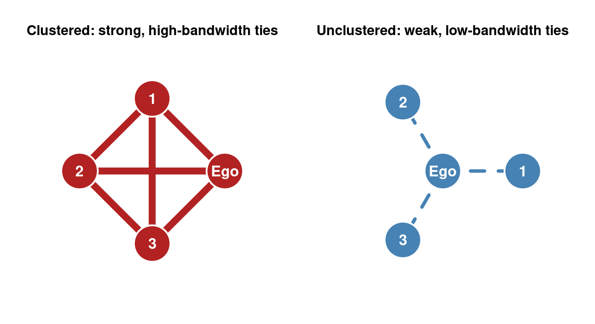
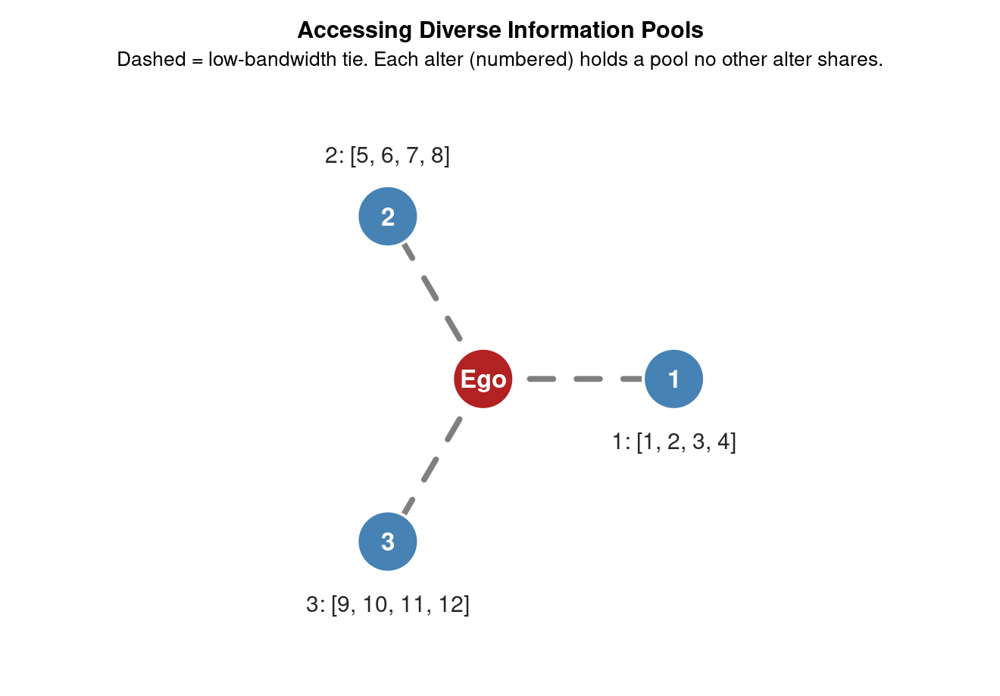
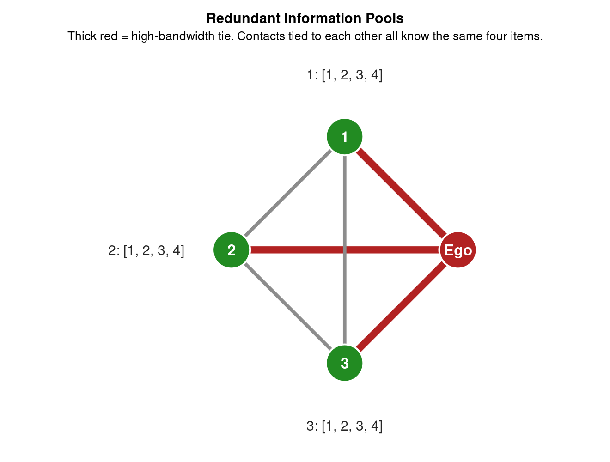
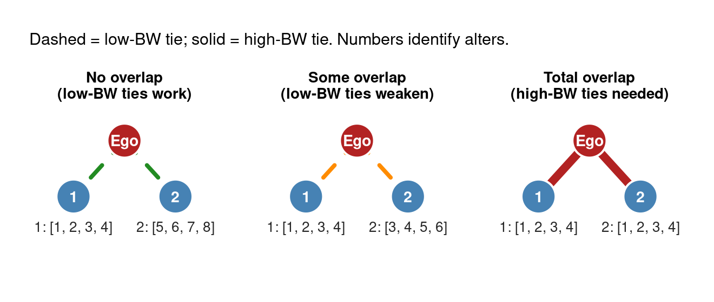

```{r setup, include=FALSE}
library(ggplot2)
library(ggraph)
library(tidygraph)
library(igraph)
library(dplyr)
library(patchwork)

# Set seed for reproducible layout of 6-node and triadic graphs
set.seed(555)

# 1. Structural Hole Live Plot
edges_sh <- data.frame(
  from = c("1","1","2","2","3", "5","5","6","6","7", "9", "9"),
  to   = c("2","3","3","4","4", "6","7","7","8","8", "1", "5")
)
nodes_sh <- data.frame(
  name = as.character(1:9),
  group = c(rep("Group A", 4), rep("Group B", 4), "Broker")
)
gr_sh <- tbl_graph(nodes = nodes_sh, edges = edges_sh, directed = FALSE)

l_coords_sh <- matrix(c(
  -1.5, 0.5,   # 1
  -2.2, 0.0,   # 2
  -1.5, -0.5,  # 3
  -2.2, -0.5,  # 4
  1.5, 0.5,    # 5
  2.2, 0.0,    # 6
  1.5, -0.5,   # 7
  2.2, -0.5,   # 8
  0.0, 0.0     # 9 (Broker)
), ncol = 2, byrow = TRUE)

p_sh <- ggraph(gr_sh, layout = "manual", x = l_coords_sh[,1], y = l_coords_sh[,2]) +
  geom_edge_link(color = "grey75", width = 1.5) +
  geom_node_point(aes(color = group), size = 14) +
  geom_node_text(aes(label = name), size = 7, fontface = "bold", color = "white") +
  scale_color_manual(values = c("Group A" = "steelblue", "Group B" = "forestgreen", "Broker" = "firebrick")) +
  theme_graph() + theme(legend.position = "none") +
  coord_cartesian(xlim = c(-2.5, 2.5), ylim = c(-1.0, 1.0), clip = "off")

# 2. Gould & Fernandez Brokerage Roles Live Plot Function
plot_brokerage <- function(node_groups, title) {
  edges_gf <- data.frame(
    from = c("A", "B"),
    to   = c("B", "C")
  )
  nodes_gf <- data.frame(
    name = c("A", "B", "C"),
    group = node_groups
  )
  g_gf <- tbl_graph(nodes = nodes_gf, edges = edges_gf, directed = TRUE)
  
  l_coords_gf <- matrix(c(
    -1.0,  0.0,  # A
     0.0,  0.8,  # B (Broker)
     1.0,  0.0   # C
  ), ncol = 2, byrow = TRUE)
  
  ggraph(g_gf, layout = "manual", x = l_coords_gf[,1], y = l_coords_gf[,2]) +
    geom_edge_link(color = "steelblue", width = 1.8,
                   arrow = arrow(length = unit(3, 'mm')),
                   end_cap = circle(7.5, 'mm'),
                   start_cap = circle(6.0, 'mm')) +
    geom_node_point(aes(color = group), size = 14) +
    geom_node_text(aes(label = name), size = 7, fontface = "bold", color = "white") +
    scale_color_manual(values = c("Group 1" = "steelblue", 
                                  "Group 2" = "forestgreen", 
                                  "Group 3" = "firebrick")) +
    labs(title = title) +
    theme_graph() + 
    coord_cartesian(xlim = c(-1.2, 1.2), ylim = c(-0.2, 1.0), clip = "off") +
    theme(plot.title = element_text(hjust = 0.5, face = "bold", size = 14, margin = margin(b = 10)),
          legend.position = "none")
}

# 3. Obstfeld Processes Live Plots
# A) Conduit (Relays info, no A-C tie)
edges_con <- data.frame(from = c("A", "B"), to = c("B", "C"))
g_con <- tbl_graph(nodes = data.frame(name = c("A", "B", "C")), edges = edges_con, directed = TRUE)
l_con <- matrix(c(-1.0, 0.0, 0.0, 0.5, 1.0, 0.0), ncol = 2, byrow = TRUE)
p_con <- ggraph(g_con, layout = "manual", x = l_con[,1], y = l_con[,2]) +
  geom_edge_link(color = "steelblue", width = 1.8, arrow = arrow(length = unit(3, 'mm')), end_cap = circle(6.5, 'mm'), start_cap = circle(5.0, 'mm')) +
  geom_node_point(size = 14, color = "tan2") +
  geom_node_text(aes(label = name), size = 7, fontface = "bold", color = "white") +
  labs(title = "Conduit Flow (Relaying)") + theme_graph() + 
  coord_cartesian(xlim = c(-1.2, 1.2), ylim = c(-0.2, 0.8), clip = "off") +
  theme(plot.title = element_text(hjust = 0.5, face = "bold", size = 14))

# B) Tertius Gaudens (Dividing, B keeps them apart/exploits)
edges_gau <- data.frame(from = c("B", "B"), to = c("A", "C"))
g_gau <- tbl_graph(nodes = data.frame(name = c("A", "B", "C")), edges = edges_gau, directed = TRUE)
l_gau <- matrix(c(-1.0, 0.0, 0.0, 0.5, 1.0, 0.0), ncol = 2, byrow = TRUE)
p_gau <- ggraph(g_gau, layout = "manual", x = l_gau[,1], y = l_gau[,2]) +
  geom_edge_link(color = "firebrick", width = 1.8, arrow = arrow(length = unit(3, 'mm')), end_cap = circle(6.5, 'mm'), start_cap = circle(5.0, 'mm')) +
  geom_node_point(size = 14, color = "tan2") +
  geom_node_text(aes(label = name), size = 7, fontface = "bold", color = "white") +
  labs(title = "Tertius Gaudens (Dividing)") + theme_graph() + 
  coord_cartesian(xlim = c(-1.2, 1.2), ylim = c(-0.2, 0.8), clip = "off") +
  theme(plot.title = element_text(hjust = 0.5, face = "bold", size = 14))

# C) Tertius Iungens (Connecting, forging a direct trust tie A-C)
# We use an undirected graph to represent the newly closed triad
edges_iun <- data.frame(
  from = c("A", "B", "A"),
  to   = c("B", "C", "C")
)
# Add an edge attribute 'type' to highlight the closed tie
g_iun <- tbl_graph(nodes = data.frame(name = c("A", "B", "C")), edges = edges_iun, directed = FALSE)
l_iun <- matrix(c(-1.0, 0.0, 0.0, 0.5, 1.0, 0.0), ncol = 2, byrow = TRUE)
# We can color the A-C link (the third edge) differently in ggraph
p_iun <- ggraph(g_iun, layout = "manual", x = l_iun[,1], y = l_iun[,2]) +
  geom_edge_link(aes(color = (node1.name == "A" & node2.name == "C") | (node1.name == "C" & node2.name == "A")), width = 1.8) +
  scale_edge_color_manual(values = c("TRUE" = "firebrick", "FALSE" = "steelblue")) +
  geom_node_point(size = 14, color = "tan2") +
  geom_node_text(aes(label = name), size = 7, fontface = "bold", color = "white") +
  labs(title = "Tertius Iungens (Connecting)") + theme_graph() + 
  coord_cartesian(xlim = c(-1.2, 1.2), ylim = c(-0.2, 0.8), clip = "off") +
  theme(plot.title = element_text(hjust = 0.5, face = "bold", size = 14), legend.position = "none")

# 4. Two-path with a structural hole (intro slide)
g_dy <- tbl_graph(nodes = data.frame(name = c("A", "B", "C")),
                  edges = data.frame(from = c("A", "B"), to = c("B", "C")), directed = TRUE)
l_dy <- matrix(c(-1.0, 0.0,  0.0, 0.7,  1.0, 0.0), ncol = 2, byrow = TRUE)
p_dy <- ggraph(g_dy, layout = "manual", x = l_dy[,1], y = l_dy[,2]) +
  geom_edge_link(color = "steelblue", width = 1.8,
                 arrow = arrow(length = unit(3, 'mm')),
                 end_cap = circle(7.5, 'mm'), start_cap = circle(6.0, 'mm')) +
  geom_node_point(size = 15, color = "tan2") +
  geom_node_text(aes(label = name), size = 7, fontface = "bold", color = "white") +
  annotate("text", x = 0, y = -0.30, label = "A and C are not tied:\nthe structural hole",
           color = "firebrick", size = 5.2, fontface = "bold", lineheight = 0.95) +
  theme_graph() +
  coord_cartesian(xlim = c(-1.25, 1.25), ylim = c(-0.60, 0.95), clip = "off")

# 5. Mini pair: open two-path vs closed triangle
make_mini <- function(closed, title) {
  edges_m <- if (closed) data.frame(from = c("A", "B", "A"), to = c("B", "C", "C"))
             else data.frame(from = c("A", "B"), to = c("B", "C"))
  g_m <- tbl_graph(nodes = data.frame(name = c("A", "B", "C")), edges = edges_m, directed = FALSE)
  l_m <- matrix(c(-0.9, -0.5,  0.0, 0.6,  0.9, -0.5), ncol = 2, byrow = TRUE)
  ggraph(g_m, layout = "manual", x = l_m[,1], y = l_m[,2]) +
    geom_edge_link(color = "steelblue", width = 1.6) +
    geom_node_point(size = 15, color = "tan2") +
    geom_node_text(aes(label = name), size = 7, fontface = "bold", color = "white") +
    labs(title = title) +
    theme_graph() +
    coord_cartesian(xlim = c(-1.1, 1.1), ylim = c(-0.8, 0.9), clip = "off") +
    theme(plot.title = element_text(hjust = 0.5, face = "bold", size = 13))
}
p_mini_pair <- make_mini(FALSE, "Open two-path") + make_mini(TRUE, "Closed triangle")

# 6. A second tie crossing the hole (redundancy)
edges_sh2 <- rbind(edges_sh, data.frame(from = "3", to = "6"))
gr_sh2 <- tbl_graph(nodes = nodes_sh, edges = edges_sh2, directed = FALSE)
p_sh2 <- ggraph(gr_sh2, layout = "manual", x = l_coords_sh[,1], y = l_coords_sh[,2]) +
  geom_edge_link(aes(color = node1.name == "3" & node2.name == "6"), width = 1.8) +
  scale_edge_color_manual(values = c("TRUE" = "firebrick", "FALSE" = "grey75")) +
  geom_node_point(aes(color = group), size = 15) +
  geom_node_text(aes(label = name), size = 7, fontface = "bold", color = "white") +
  scale_color_manual(values = c("Group A" = "steelblue", "Group B" = "forestgreen", "Broker" = "firebrick")) +
  theme_graph() + theme(legend.position = "none") +
  coord_cartesian(xlim = c(-2.5, 2.5), ylim = c(-1.0, 1.0), clip = "off")

# 7. Ego networks: high vs low constraint
plot_ego_c <- function(closed, title) {
  al <- c("a", "b", "c", "d")
  edges_e <- data.frame(from = rep("Ego", 4), to = al)
  if (closed) {
    pr <- combn(al, 2, simplify = FALSE)
    edges_e <- rbind(edges_e, data.frame(from = sapply(pr, `[`, 1), to = sapply(pr, `[`, 2)))
  }
  nm <- c("Ego", al)
  g_e <- tbl_graph(nodes = data.frame(name = nm, role = ifelse(nm == "Ego", "Ego", "Alter")),
                   edges = edges_e, directed = FALSE)
  ang <- (0:3) * pi/2 + pi/4
  l_e <- rbind(c(0, 0), cbind(cos(ang), sin(ang)) * 1.15)
  ggraph(g_e, layout = "manual", x = l_e[,1], y = l_e[,2]) +
    geom_edge_link(color = "grey65", width = 1.4) +
    geom_node_point(aes(color = role), size = 15, show.legend = FALSE) +
    geom_node_text(aes(label = name), size = 7, fontface = "bold", color = "white") +
    scale_color_manual(values = c(Ego = "firebrick", Alter = "tan2")) +
    labs(title = title) +
    theme_graph() +
    coord_cartesian(xlim = c(-1.45, 1.45), ylim = c(-1.45, 1.45), clip = "off") +
    theme(plot.title = element_text(hjust = 0.5, face = "bold", size = 13))
}
p_ego_hi <- plot_ego_c(TRUE, "High constraint: closed")
p_ego_lo <- plot_ego_c(FALSE, "Low constraint: open")

# 8. Three determinants of constraint
det_plot <- function(names, edges_df, coords, title, hl = "Ego") {
  g_d <- tbl_graph(nodes = data.frame(name = names, role = ifelse(names == hl, "Focus", "Other")),
                   edges = edges_df, directed = FALSE)
  ggraph(g_d, layout = "manual", x = coords[,1], y = coords[,2]) +
    geom_edge_link(color = "grey65", width = 1.3) +
    geom_node_point(aes(color = role), size = 14, show.legend = FALSE) +
    geom_node_text(aes(label = name), size = 7, fontface = "bold", color = "white") +
    scale_color_manual(values = c(Focus = "firebrick", Other = "tan2")) +
    labs(title = title) +
    coord_cartesian(xlim = c(min(coords[,1]) - 0.45, max(coords[,1]) + 0.45),
                    ylim = c(min(coords[,2]) - 0.45, max(coords[,2]) + 0.45)) +
    theme_graph() +
    theme(plot.title = element_text(hjust = 0.5, face = "bold", size = 12.5))
}

# Size: six alters, none of them tied to each other
al6 <- c("a", "b", "c", "d", "e", "f")
ang6 <- (0:5) * pi/3
e_size <- data.frame(from = rep("Ego", 6), to = al6)
p_size <- det_plot(c("Ego", al6), e_size,
                   rbind(c(0, 0), cbind(cos(ang6), sin(ang6)) * 1.15),
                   "1. Size: many alters")

# Density: three alters, all tied to each other
al3 <- c("a", "b", "c")
pr3 <- combn(al3, 2, simplify = FALSE)
e_dens <- rbind(data.frame(from = rep("Ego", 3), to = al3),
                data.frame(from = sapply(pr3, `[`, 1), to = sapply(pr3, `[`, 2)))
ang3 <- c(pi/2, pi/2 + 2*pi/3, pi/2 + 4*pi/3)
p_dens <- det_plot(c("Ego", al3), e_dens,
                   rbind(c(0, 0), cbind(cos(ang3), sin(ang3)) * 1.15),
                   "2. Density: alters all tied")

# Hierarchy: a, b, c reach each other only through the hub q
e_hier <- data.frame(from = c("Ego", "Ego", "Ego", "Ego", "q", "q", "q"),
                     to   = c("a", "b", "c", "q", "a", "b", "c"))
l_hier <- matrix(c(-1.3, 0.0,   # Ego
                    0.1, 0.0,   # q (hub)
                    1.3, 0.75,  # a
                    1.3, 0.0,   # b
                    1.3, -0.75), ncol = 2, byrow = TRUE)
p_hier <- det_plot(c("Ego", "q", "a", "b", "c"), e_hier, l_hier,
                   "3. Hierarchy: ties funnel through q", hl = "q")

# 9. Idea generation: broker between two information pools
idea_nodes <- data.frame(name = c("A1", "A2", "A3", "B1", "B2", "B3", "B"),
                         grp = c(rep("pA", 3), rep("pB", 3), "brok"))
idea_edges <- data.frame(from = rep("B", 6), to = c("A1", "A2", "A3", "B1", "B2", "B3"))
g_idea <- tbl_graph(nodes = idea_nodes, edges = idea_edges, directed = FALSE)
l_idea <- rbind(cbind(-1.4, c(0.8, 0, -0.8)), cbind(1.4, c(0.8, 0, -0.8)), c(0, 0))
p_idea <- ggraph(g_idea, layout = "manual", x = l_idea[,1], y = l_idea[,2]) +
  geom_edge_link(color = "grey75", width = 1.4) +
  geom_node_point(aes(color = grp), size = 14, show.legend = FALSE) +
  geom_node_text(aes(label = name), size = 7, fontface = "bold", color = "white") +
  scale_color_manual(values = c(pA = "steelblue", pB = "forestgreen", brok = "firebrick")) +
  annotate("text", x = -1.4, y = 1.35, label = "Group A's pool", size = 5, fontface = "bold", color = "steelblue") +
  annotate("text", x = 1.4, y = 1.35, label = "Group B's pool", size = 5, fontface = "bold", color = "forestgreen") +
  theme_graph() +
  coord_cartesian(xlim = c(-1.9, 1.9), ylim = c(-1.05, 1.55), clip = "off")

# 10. Stylized constraint-reward gradient (Empirical Findings slide)
p_reward <- ggplot(data.frame(x = c(0, 1)), aes(x)) +
  stat_function(fun = function(x) 1.05 - 0.85 * x, color = "steelblue", linewidth = 1.6) +
  scale_y_continuous(limits = c(0, 1.45), breaks = NULL, labels = NULL) +
  scale_x_continuous(breaks = c(0, 1), labels = c("Low\n(open network)", "High\n(closed network)")) +
  labs(x = "Network constraint", y = "Organizational rewards") +
  annotate("text", x = 0.03, y = 1.38, label = "Brokers: higher salary,\nfaster promotion,\nbetter evaluations",
           hjust = 0, size = 4.6, fontface = "bold", color = "firebrick", lineheight = 0.95) +
  theme_minimal(base_size = 15) +
  theme(panel.grid = element_blank(),
        axis.title = element_text(face = "bold"),
        axis.text.x = element_text(face = "bold"))

# 11. Gould & Fernandez triad: Source -> Broker -> Target
g_gfr <- tbl_graph(nodes = data.frame(name = c("A", "B", "C")),
                   edges = data.frame(from = c("A", "B"), to = c("B", "C")), directed = TRUE)
l_gfr <- matrix(c(-1.0, 0.0,  0.0, 0.7,  1.0, 0.0), ncol = 2, byrow = TRUE)
p_gfr <- ggraph(g_gfr, layout = "manual", x = l_gfr[,1], y = l_gfr[,2]) +
  geom_edge_link(color = "steelblue", width = 1.8, arrow = arrow(length = unit(3, 'mm')),
                 end_cap = circle(7.5, 'mm'), start_cap = circle(6.0, 'mm')) +
  geom_node_point(size = 15, color = "tan2") +
  geom_node_text(aes(label = name), size = 7, fontface = "bold", color = "white") +
  annotate("text", x = -1.0, y = -0.30, label = "Source", size = 5.2, fontface = "bold") +
  annotate("text", x = 0.0, y = 0.98, label = "Broker", size = 5.2, fontface = "bold") +
  annotate("text", x = 1.0, y = -0.30, label = "Target", size = 5.2, fontface = "bold") +
  theme_graph() +
  coord_cartesian(xlim = c(-1.25, 1.25), ylim = c(-0.50, 1.10), clip = "off")

# 12. Worked constraint example: ego E; alters a, b (tied to each other) and c (isolated)
g_wk <- tbl_graph(nodes = data.frame(name = c("E", "a", "b", "c"),
                                     role = ifelse(c("E", "a", "b", "c") == "E", "Ego", "Alter")),
                  edges = data.frame(from = c("E", "E", "E", "a"), to = c("a", "b", "c", "b")),
                  directed = FALSE)
l_wk <- matrix(c(-1.2, 0.0,   # E
                  0.6, 0.85,  # a
                  0.6, -0.85, # b
                  1.7, 0.0), ncol = 2, byrow = TRUE)  # c
p_wk <- ggraph(g_wk, layout = "manual", x = l_wk[,1], y = l_wk[,2]) +
  geom_edge_link(color = "grey65", width = 1.6) +
  geom_node_point(aes(color = role), size = 15, show.legend = FALSE) +
  geom_node_text(aes(label = name), size = 7, fontface = "bold", color = "white") +
  scale_color_manual(values = c(Ego = "firebrick", Alter = "tan2")) +
  theme_graph() +
  coord_cartesian(xlim = c(-1.5, 2.0), ylim = c(-1.1, 1.1), clip = "off")
```

## From Dyads to Triads: Introduction to Brokerage

::: {.columns}
::: {.column width="52%"}
- Moving from **dyads** to **triads** introduces group-level dynamics: Georg Simmel (1908) showed that a third actor creates options for alliance, conflict, and **intermediation**.

- **Intermediation** is a two-path: A is tied to B, B is tied to C, but A and C are **not** tied — B stands between them.

- Gaps between disconnected actors are opportunities for **control** and **information flow**.

- Ronald Burt's **Structural Holes Theory (SHT)** (1992, 1995) formalizes these gaps as a key source of **social capital**.
:::

::: {.column width="48%"}
```{r}
#| echo: false
#| fig-height: 3.4
#| fig-width: 4.6
p_dy
```
:::
:::

---

## What is a Structural Hole?

::: {.columns}
::: {.column width="50%"}
- **Definition**:
  - A **structural hole** is the absence of a tie between two parts of a social network.
  - In graph-theoretic terms, they are **two-paths that are not closed triangles**.

- **Open vs. Closed Networks**:
  - Densely connected, high-**clustering** groups (friends of friends are friends) lack structural holes.
  - Disconnected clusters leave holes between them.
  
- **The Broker**:
  - An actor who spans or "fills" a structural hole is a **broker**.
:::

::: {.column width="50%"}
```{r}
#| echo: false
#| fig-height: 3.0
#| fig-width: 5.5
p_mini_pair
```
- **Redundancy**: in closed networks, everyone hears the same things. Spanning a hole buys access to **non-redundant** information.
:::
:::

---

## Visualizing a Structural Hole

::: {.columns}
::: {.column width="45%"}
- **The Spanning Structure**:
  - Group A (blue) is internally cohesive and densely connected.
  - Group B (green) is also internally cohesive and densely connected.
  - There is a **structural hole** (gap) between Group A and Group B.
  - The **Broker** (red) is the only node connecting Group A and Group B.
  - **Result**: All information, influence, and resources flowing between the groups must pass through the broker.
:::

::: {.column width="55%"}
```{r}
#| echo: false
#| fig-height: 4.8
#| fig-width: 5.5
p_sh
```
:::
:::

---

## When a Hole Starts to Close: Redundancy

::: {.columns}
::: {.column width="45%"}
```{r}
#| echo: false
#| fig-height: 4.2
#| fig-width: 4.6
p_sh2
```
:::

::: {.column width="55%"}
- Same two groups, same red broker — but now a **second channel** (the red tie 3–6) crosses the gap.

- Information can **route around** the broker: node 9's control advantage shrinks, and the two channels carry overlapping news.

- Burt's point: a broker position is valuable because it is **exclusive**. Every extra tie across a hole makes ego's contacts more **redundant** — and the hole less profitable.
:::
:::

---

## Twin Benefits of Structural Holes

Burt (1995): bridging structural holes pays off in two distinct currencies.

::: {.columns}
::: {.column width="50%"}
**1. Information access (passive)**

- Disconnected groups hold **different pools** of knowledge and contacts.

- The broker hears things no single group member hears, and can **combine** them into novel ideas.
:::

::: {.column width="50%"}
**2. Control (active)**

- **Gatekeeping**: shaping what flows between the groups.

- **Tertius gaudens**: playing disconnected actors against one another.

- **Behavioral freedom**: no single group's norms and expectations fully bind the broker.
:::
:::

---

## Network Constraint: The Inverse of Structural Holes

::: {.columns}
::: {.column style="width: 32%"}
```{r}
#| echo: false
#| fig-height: 3.4
#| fig-width: 3.4
p_ego_hi
```
:::

::: {.column style="width: 32%"}
```{r}
#| echo: false
#| fig-height: 3.4
#| fig-width: 3.4
p_ego_lo
```
:::

::: {.column style="width: 34%"}
- **High constraint**: ego's contacts are tied to *each other*. News repeats; a single group's expectations bind ego.

- **Low constraint**: ego's contacts are **disconnected**. Each alter is a separate doorway to a different circle.

- Constraint is the mirror image of brokerage opportunity.
:::
:::

---

## Determinants of Network Constraint

::: {.columns}
::: {.column style="width: 33%"}
```{r}
#| echo: false
#| fig-height: 3.0
#| fig-width: 3.3
p_size
```
**Size**: many alters are hard to close — bigger networks leave more holes.
:::

::: {.column style="width: 33%"}
```{r}
#| echo: false
#| fig-height: 3.0
#| fig-width: 3.3
p_dens
```
**Density**: alters tied to *each other* say the same things — redundant information, high constraint.
:::

::: {.column style="width: 33%"}
```{r}
#| echo: false
#| fig-height: 3.0
#| fig-width: 3.3
p_hier
```
**Hierarchy**: when all routes between ego's contacts run through one hub ($q$), ego depends on that channel.
:::
:::

*(The formula behind these three ingredients lives in the optional appendix at the end of the deck.)*

---

## Empirical Findings: SHT in Corporate Settings

::: {.columns}
::: {.column width="46%"}
Burt's corporate studies (2004, 2005) compare managers who differ in network constraint:

- **Higher salaries** for low-constraint senior managers and executives.
- **Faster promotions** to higher ranks.
- **Better performance evaluations** from their organizations.

**Rank nuance**: constraint matters little for entry-level managers, whose work is standardized. For senior managers and executives, it is a critical predictor of rewards.
:::

::: {.column width="54%"}
```{r}
#| echo: false
#| fig-height: 3.6
#| fig-width: 5.2
p_reward
```
Stylized gradient, not data: the finding is a **negative** association between constraint and organizational reward.
:::
:::

---

## Idea Generation: The Broker's Creative Edge

::: {.columns}
::: {.column width="45%"}
```{r}
#| echo: false
#| fig-height: 3.4
#| fig-width: 4.6
p_idea
```
:::

::: {.column width="55%"}
- Why do brokers perform better? Burt (2004): they **generate better ideas**.

- Densely clustered groups are **echo chambers**; each pool recycles the same assumptions.

- Brokers sit **between pools** and can select, translate, and combine ideas that never meet inside either group.

- The value is in the **recombination**: either group can produce A1 or B2; only the broker can produce the synthesis.
:::
:::

---

## Gould & Fernandez: Typology of Brokerage Roles

::: {.columns}
::: {.column width="52%"}
- Gould and Fernandez (1989) treat brokerage as a **triadic role**: a **Source** sends, a **Broker** intermediates, a **Target** receives.

- Partition the nodes into social groups, and the **group memberships** of the three actors define **five brokerage roles**.

- The roles separate **within-group** intermediation (Coordinator, Consultant) from **between-group** intermediation (Gatekeeper, Representative, Liaison).
:::

::: {.column width="48%"}
```{r}
#| echo: false
#| fig-height: 3.6
#| fig-width: 4.2
p_gfr
```
:::
:::

---

## 1. Coordinator (Within-Group Brokerage)

::: {.columns}
::: {.column width="55%"}
- **Definition**:
  - The **Source**, the **Broker**, and the **Target** all belong to the **same social group** (Group 1).
- **Core Action**:
  - The broker acts as an **internal facilitator**, helping to coordinate relations, resolve blockages, and synthesize ideas within their own cohesive cluster.
- **Sociological Significance**:
  - Highlights **local integration** and group-level cohesion, making sure internal cliques communicate smoothly.
- **Real-World Example**:
  - An **internal project manager** linking two disconnected engineers within the same department.
:::

::: {.column width="45%"}
<center>
```{r}
#| echo: false
#| fig-height: 4.8
#| fig-width: 4.8
plot_brokerage(c("Group 1", "Group 1", "Group 1"), "1. Coordinator")
```
</center>
:::
:::

---

## 2. Itinerant Broker / Consultant (Within-Group)

::: {.columns}
::: {.column width="55%"}
- **Definition**:
  - The **Source** and the **Target** belong to the **same group** (Group 1), but the **Broker** is an **outsider** (member of Group 2).
- **Core Action**:
  - The broker provides **external mediation** or **unbiased consulting**, acting as an objective intermediary between two insiders.
- **Sociological Significance**:
  - Demonstrates **impartial intermediation** where groups recruit third-party experts to facilitate internal relations.
- **Real-World Example**:
  - An **external mediator** or consultant brought in to resolve a dispute between two executives in the same company.
:::

::: {.column width="45%"}
<center>
```{r}
#| echo: false
#| fig-height: 4.8
#| fig-width: 4.8
plot_brokerage(c("Group 1", "Group 2", "Group 1"), "2. Itinerant Broker (Consultant)")
```
</center>
:::
:::

---

## 3. Gatekeeper (Between-Group Brokerage)

::: {.columns}
::: {.column width="55%"}
- **Definition**:
  - The **Source** is an **outsider** (Group 1), but the **Broker** and the **Target** belong to the **same group** (Group 2).
- **Core Action**:
  - The broker controls **inward boundary spanning**, deciding whether to admit, block, or filter external information, resources, or actors entering their group.
- **Sociological Significance**:
  - Represents **gatekeeping power**, protecting group boundaries and filtering noise.
- **Real-World Example**:
  - An **executive assistant** filtering which client calls or emails reach their supervisor.
:::

::: {.column width="45%"}
<center>
```{r}
#| echo: false
#| fig-height: 4.8
#| fig-width: 4.8
plot_brokerage(c("Group 1", "Group 2", "Group 2"), "3. Gatekeeper")
```
</center>
:::
:::

---

## 4. Representative (Between-Group Brokerage)

::: {.columns}
::: {.column width="55%"}
- **Definition**:
  - The **Source** and the **Broker** belong to the **same group** (Group 1), while the **Target** is an **outsider** (Group 2).
- **Core Action**:
  - The broker controls **outward boundary spanning**, acting as a spokesperson or link who represents their group to the external world.
- **Sociological Significance**:
  - Represents **external representation**, projecting group voice and managing outgoing resources.
- **Real-World Example**:
  - A **PR officer** or **sales representative** presenting their department's work to external clients.
:::

::: {.column width="45%"}
<center>
```{r}
#| echo: false
#| fig-height: 4.8
#| fig-width: 4.8
plot_brokerage(c("Group 1", "Group 1", "Group 2"), "4. Representative")
```
</center>
:::
:::

---

## 5. Liaison (Between-Group Brokerage)

::: {.columns}
::: {.column width="55%"}
- **Definition**:
  - The **Source** (Group 1), the **Broker** (Group 2), and the **Target** (Group 3) all belong to **three completely different groups**.
- **Core Action**:
  - The broker provides **cross-boundary mediation**, linking entirely disparate social worlds without belonging to either. This is the **most expansive** and least constrained form of brokerage.
- **Sociological Significance**:
  - Acts as a **structural bridge** connecting disconnected societies, vital for systemic innovation.
- **Real-World Example**:
  - A **real estate agent** connecting a buyer from one city with a seller from another.
:::

::: {.column width="45%"}
<center>
```{r}
#| echo: false
#| fig-height: 4.8
#| fig-width: 4.8
plot_brokerage(c("Group 1", "Group 2", "Group 3"), "5. Liaison")
```
</center>
:::
:::

---

## Brokerage as a Process: Action vs. Structure

- **Action vs. Structure**:
  - Obstfeld, Borgatti, and Davis (2014) argue that a structural hole is only a **structural opportunity**.
  - Realizing the benefits of brokerage requires **motivation and active social action**.
  - They decouple brokerage behavior from network structure:
    - Brokerage can occur even between parties who **already interact**, acting as a facilitation process.
    - Having a structural hole does **not guarantee** that brokerage will take place.
- **Strategic Orientations**:
  - They distinguish between **three primary brokerage orientations (behaviors)**:
    1. **Conduit**: Ego mediates information/resource flows.
    2. **Tertius Gaudens**: Ego exploits gaps and keeps alters disconnected.
    3. **Tertius Iungens**: Ego actively connects and unites alters.

---

## 1. The Conduit Process

::: {.columns}
::: {.column width="55%"}
- **Core Action**:
  - The broker simply **transfers information, ideas, or solutions** between two parties without attempting to change the underlying relationship between them.
- **Key Characteristics**:
  - B acts as a **passive transmitter** or **relay**.
  - Alters A and C may never meet, or even become aware of each other's existence.
  - Value is generated through the **synthesis** of disparate knowledge bases.
- **Real-World Example**:
  - A **retailer** who buys products from manufacturers (A) and sells them to consumers (C) without connecting them directly.
:::

::: {.column width="45%"}
<center>
```{r}
#| echo: false
#| fig-height: 4.5
#| fig-width: 4.5
p_con
```
</center>
:::
:::

---

## 2. The Tertius Gaudens Orientation

::: {.columns}
::: {.column width="55%"}
- **Core Action**:
  - Translating from Latin to **"the third who benefits"** (Simmel, 1950), the broker actively exploits the separation of alters.
- **Key Characteristics**:
  - B stands between A and C and **maintains the gap**, keeping them disconnected or actively **encouraging conflict/competition** between them.
  - Also known as **divide et impera** (**divide and conquer**).
  - Maximizes the broker's **control advantage** and **information arbitrage**.
- **Real-World Example**:
  - A **manager** who prevents two employees from collaborating directly so they remain dependent on the manager for coordination and praise.
:::

::: {.column width="45%"}
<center>
```{r}
#| echo: false
#| fig-height: 4.2
#| fig-width: 4.2
# Let's draw the Tertius Gaudens plot where B separates A and C
g_tg <- tbl_graph(nodes = data.frame(name=c("A", "B", "C"), group=c("Group 1", "Group 2", "Group 1")),
                  edges = data.frame(from=c("B", "B"), to=c("A", "C")), directed=TRUE)
l_coords_tg <- matrix(c(-1.0, 0.0,  0.0, 0.8,  1.0, 0.0), ncol=2, byrow=TRUE)
ggraph(g_tg, layout = "manual", x = l_coords_tg[,1], y = l_coords_tg[,2]) +
  geom_edge_link(color = "steelblue", width = 1.8, arrow = arrow(length = unit(3, 'mm')), end_cap = circle(7.5, 'mm'), start_cap = circle(6.0, 'mm')) +
  geom_node_point(aes(color = group), size = 14) +
  geom_node_text(aes(label = name), size = 7, fontface = "bold", color = "white") +
  scale_color_manual(values = c("Group 1" = "steelblue", "Group 2" = "forestgreen")) +
  theme_graph() + theme(legend.position = "none") +
  coord_cartesian(xlim = c(-1.2, 1.2), ylim = c(-0.2, 1.0), clip = "off")
```
</center>
:::
:::

---

## 3. The Tertius Iungens Orientation

::: {.columns}
::: {.column width="55%"}
- **Core Action**:
  - Translating from Latin to **"the third who joins"** (Obstfeld, 2005), the broker actively connects or facilitates interactions between alters.
- **Key Characteristics**:
  - B **introduces A and C**, closing the structural hole by creating a new direct connection between them.
  - Focuses on **coordinating collaborative action**, **joint problem-solving**, and **building trust**.
  - Ego may step back after introducing them (**introduce-and-depart**), sacrificing their long-term structural advantage for immediate collaborative value.
- **Real-World Example**:
  - A **matchmaker** who introduces two entrepreneurs with complementary skills to start a new business together.
:::

::: {.column width="45%"}
<center>
```{r}
#| echo: false
#| fig-height: 4.5
#| fig-width: 4.5
p_iun
```
- A new **direct relationship link** is forged between A and C (highlighted in red), closing the structural hole.
</center>
:::
:::

---

## Decoupling Action from Structure: The Obstfeld Matrix

- Obstfeld et al. (2014): **three strategic orientations** under **two network structures** (Open vs. Closed) — action is decoupled from structural holes.

**Open Network** *(Absence of an A–C tie)*:

| | **Conduit** | **Tertius Gaudens** | **Tertius Iungens** |
|:---|:---|:---|:---|
| **Strategic Action** | **Information Transfer**:B transfers information, knowledge, or resources between A and C where they have no prior connection. | **Arbitrage & Separation**:B plays A and C against one another, or actively keeps them apart to maintain control. | **Introducing Alters**:B introduces A and C, closing the structural hole by creating a new tie. |

---

## The Obstfeld Matrix: Closed Networks

**Closed Network** *(Presence of an A–C tie)*:

| | **Conduit** | **Tertius Gaudens** | **Tertius Iungens** |
|:---|:---|:---|:---|
| **Strategic Action** | **Facilitated Synthesis**:B facilitates transfer between already-connected A and C and helps synthesize new knowledge. | **Divide et Impera (Divide & Rule)**:B cultivates conflict, competition, or separation between A and C. | **Coordinated Collaboration**:B coordinates new collaborative action or deepens partnership between A and C. |

---

## SHT meets SWT: The Diversity-Bandwidth Tradeoff

- Aral and Van Alstyne (2011) extend Granovetter's Strength of Weak Ties (SWT) theory by incorporating **temporal flow** and **information complexity**.

- **Static vs. Dynamic View**:
  - Granovetter's original theory conceives of tie properties (e.g., tie strength) in static terms.
  - In reality, information transmission and access are **events that happen in time**.

- **The Core Tradeoff**:
  - Accessing novel information through social networks involves a tradeoff between **information diversity** and **channel bandwidth**.

---

## Visualizing Bandwidth vs. Clustering

::: {.columns}
::: {.column width="45%"}
- **Two Network Configurations**:
  - **High Bandwidth + High Clustering**:
    - Densely connected networks where strong ties facilitate rapid, frequent communication.
  - **Low Bandwidth + Low Clustering**:
    - Sparse, open networks where weak ties connect ego to disconnected contacts at lower transmission rates.
:::

::: {.column width="55%"}
{fig-align="center" width="660px"}
:::
:::

---

## What is Tie Bandwidth?

- **Tie Bandwidth**:
  - The rate or frequency at which information is transmitted through a social tie.
  - **Weak Ties** = Low bandwidth (slower, less frequent communication events).
  - **Strong Ties** = High bandwidth (faster, highly frequent communication events).

- **The Tradeoff Paradox**:
  - Weak ties offer high **diversity** (access to novel circles) but low **bandwidth**.
  - Strong ties offer high **bandwidth** but low **diversity** (due to triadic closure and local redundancy).

---

## Information Complexity & Channel Capacity

- **Simple Information**:
  - Simple, non-complex details (e.g., job leads, rumors, product recommendations).
  - Easily transmitted through **low-bandwidth weak ties**.

- **Complex Information**:
  - Tacit, highly interdependent, or complex knowledge (e.g., learning R programming, complex organizational procedures).
  - Requires **high-bandwidth strong ties** due to:
    - Higher trust, intimacy, and cooperativeness.
    - Better shared memory of "who knows what."
    - Active problem-solving and collective synthesis.

---

## Accessing Diverse Information Pools

::: {.columns}
::: {.column width="45%"}
- **Condition for Weak Ties**:
  - Low-bandwidth (weak) ties are highly efficient when contacts possess **diverse, non-overlapping information pools**.
  
- **Visual Example**:
  - Alter 1 knows `[1, 2, 3, 4]`.
  - Alter 2 knows `[5, 6, 7, 8]`.
  - Alter 3 knows `[9, 10, 11, 12]`.
  - Because their information does not overlap, Ego maximizes diversity at minimal bandwidth cost.
:::

::: {.column width="55%"}
{fig-align="center" width="660px"}
:::
:::

---

## Redundant Information Pools

::: {.columns}
::: {.column width="45%"}
- **Condition for Strong Ties**:
  - Weak ties lose their advantage if contacts are connected and possess **redundant/homogeneous information**.
  
- **Visual Example**:
  - Alters talk to each other and all know `[1, 2, 3, 4]`.
  - Low-bandwidth ties simply receive the same redundant information slowly.
  - In this case, **strong, high-bandwidth ties are better** because they provide faster, deeper access to the complex details of `[1, 2, 3, 4]`.
:::

::: {.column width="55%"}
{fig-align="center" width="660px"}
:::
:::

---

## The Information Overlap Spectrum

::: {.columns}
::: {.column width="45%"}
- **Tie Preferences and Overlap**:
  - The choice between low-bandwidth and high-bandwidth ties depends on the **degree of information overlap** among contacts:
  - **No Overlap**: Low-bandwidth ties are highly effective.
  - **Some Overlap**: Low-bandwidth ties start losing their efficiency.
  - **Total Overlap**: Low-bandwidth ties are worse; high-bandwidth channels are preferred to transfer complex details quickly.
:::

::: {.column width="55%"}
{fig-align="center" width="660px"}
:::
:::

---


## Summary of Ronald Burt's SHT

- **The Value of Spanning Gaps**:
  - Gaps in social structures (structural holes) create opportunities for social capital.

- **Redundancy vs. Brokerage**:
  - Densely clustered networks (high constraint) lead to redundant information.
  - Open networks (low constraint) provide information access (passive) and control benefits (active).

- **Action is Key**:
  - Structure provides opportunities, but brokerage processes (Conduit, Tertius Gaudens, Tertius Iungens) represent the actual behavior of brokers.

- **Bandwidth Matters**:
  - Social capital is a function of both network structure and the information environment. Open networks are best for simple, diverse info; closed networks are best for complex, tacit knowledge.

---

## Optional: The Dyadic Constraint Formula

*The next three slides are optional math detail; the conceptual story is complete without them.*

::: {.columns}
::: {.column style="width: 54%"}
- The constraint $c_{ij}$ that alter $j$ exerts on ego $i$ is calculated as:

$$c_{ij} = \left(p_{ij} + \sum_{q \neq i,j} p_{iq} p_{qj}\right)^2$$

- The **square** penalizes concentration: dependence on any single alter costs ego quadratically.
:::

::: {.column style="width: 42%"}
- **Reading the formula**:
  - **Direct investment** $p_{ij}$: the more ego relies on $j$, the more $j$ can constrain ego.
  - **Indirect investment** $\sum_q p_{iq}p_{qj}$: mutual contacts $q$ give ego second-hand routes to $j$, tightening dependence.
:::
:::

---

## Optional: The Investment Shares $p_{ij}$

::: {.columns}
::: {.column style="width: 54%"}
- $p_{ij}$ is the proportion of ego $i$'s network investment (tie strength, time, or frequency) dedicated to alter $j$:

$$p_{ij} = \frac{z_{ij} + z_{ji}}{\sum_{k} (z_{ik} + z_{ki})}$$
:::

::: {.column style="width: 42%"}
- **Numerator**: the mutual strength of the $i$–$j$ tie.

- **Denominator**: ego's total investment across all alters.

- The shares sum to 1 across alters, so concentrating investment in a few alters raises every $p_{ij}$ — and with it, constraint.
:::
:::

---

## Optional: Aggregate Constraint

::: {.columns}
::: {.column style="width: 46%"}
- **Aggregate network constraint** sums the dyadic constraints over all of ego's alters:

$$C_i = \sum_{j} c_{ij}$$
:::

::: {.column style="width: 50%"}
- **High $C_i$**: a closed, redundant ego network — few holes to span, strong group expectations.

- **Low $C_i$**: an open ego network rich in structural holes — the broker's position.

- Burt's empirical claim: low $C_i$ predicts higher salaries, faster promotions, and better evaluations, at least for senior managers.
:::
:::

---

## Optional: A Worked Constraint Example

::: {.columns}
::: {.column style="width: 36%"}
```{r}
#| echo: false
#| fig-height: 3.2
#| fig-width: 3.6
p_wk
```
:::

::: {.column style="width: 62%"}
- Every tie has strength 1, and each contributes $z_{Ej} + z_{jE} = 2$ to ego's total investment of 6; so each direct share is $p_{Ej} = 1/3$.

| Alter | Direct $p_{Ej}$ | Indirect $\sum_q p_{Eq} p_{qj}$ | $c_{Ej}$ |
|:--|:--|:--|:--|
| a | 0.33 | 0.17 (via b) | **0.25** |
| b | 0.33 | 0.17 (via a) | **0.25** |
| c | 0.33 | 0.00 | 0.11 |

- Aggregate: $C_E = 0.25 + 0.25 + 0.11 = 0.61$.

- **Read the contrast**: the mutual tie between a and b raises their constraint on Ego above c's. Ego can reach each of them through the other, and they can act jointly. The isolated alter c is the hole Ego could span.
:::
:::
