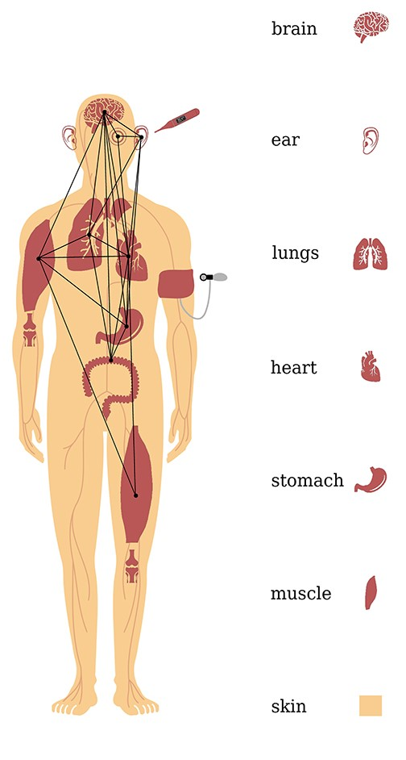

```{r setup, include=FALSE}
library(ggplot2)
library(ggraph)
library(tidygraph)
library(igraph)
library(dplyr)
library(kableExtra)
library(patchwork)
library(factoextra)

# ---- The persistent 12-node graph (A-L) used throughout the deck ----------
# K4 {A,B,C,D} + K5 {E,F,G,H,I}, bridged by B-E and D-F; triangle {D,F,K};
# triangle {J,K,L} hanging off K. 23 edges. Verified against the reference
# deck's numbers: 16 size-3 + 6 size-4 + 1 size-5 cliques = 23 total.
g12_edges <- rbind(
    data.frame(from = "A", to = c("B", "C", "D")),
    data.frame(from = "B", to = c("C", "D", "E")),
    data.frame(from = "C", to = c("D")),
    data.frame(from = "D", to = c("F", "K")),
    data.frame(from = "E", to = c("F", "G", "H", "I")),
    data.frame(from = "F", to = c("G", "H", "I", "K")),
    data.frame(from = "G", to = c("H", "I")),
    data.frame(from = "H", to = c("I")),
    data.frame(from = "J", to = c("K", "L")),
    data.frame(from = "K", to = c("L"))
)
g12_edges <- do.call(rbind, lapply(seq_len(nrow(g12_edges)), function(i)
    data.frame(from = g12_edges$from[i], to = g12_edges$to[[i]])))
g12 <- graph_from_data_frame(g12_edges, directed = FALSE)
g12 <- simplify(g12)
stopifnot(length(V(g12)) == 12, length(E(g12)) == 23,
          sum(sapply(cliques(g12, min = 3), length) == 3) == 16,
          sum(sapply(cliques(g12, min = 4), length) == 4) == 6,
          sum(sapply(cliques(g12, min = 5), length) == 5) == 1)
lay12 <- data.frame(
    name = LETTERS[1:12],
    x = c(-3.0, -4.0, -3.0, -1.8,  1.5, 3.2, 2.6, 0.4, -0.2, 1.9, 0.8, -0.3),
    y = c( 1.2,  0.0, -1.2,  0.0,  1.8, 0.55, -1.45, -1.45, 0.55, -3.6, -2.6, -3.6)
)
MUTE <- "grey78"

# Plot the 12-node graph, optionally highlighting an induced subgraph.
# Nodes in `hl` are green; edges with both ends in `hl` are orange and thicker.
plot_g12 <- function(hl = character(), node_size = 12, lab = 6.5,
                     edge_w = 1.1, hl_edge = "orange", hl_edges = NULL) {
    en <- ends(g12, E(g12))
    if (!is.null(hl_edges)) {
        key <- function(m) paste(pmin(m[,1], m[,2]), pmax(m[,1], m[,2]), sep = "-")
        targets <- key(do.call(rbind, lapply(hl_edges, function(p)
            matrix(p, 1, 2))))
        in_hl <- key(en) %in% targets
        ecol <- ifelse(in_hl, hl_edge, MUTE)
        ewd <- ifelse(in_hl, 2.2, edge_w)
        ncol <- rep("tan2", 12)
    } else {
        in_hl <- en[,1] %in% hl & en[,2] %in% hl
        ecol <- if (length(hl)) ifelse(in_hl, hl_edge, MUTE) else "steelblue"
        ewd <- if (length(hl)) ifelse(in_hl, 2.2, edge_w) else edge_w
        ncol <- if (length(hl)) ifelse(V(g12)$name %in% hl, "forestgreen", "tan2") else "tan2"
    }
    ggraph(g12, layout = "manual", x = lay12$x[match(V(g12)$name, lay12$name)],
           y = lay12$y[match(V(g12)$name, lay12$name)]) +
        geom_edge_link(aes(color = ecol, width = ewd), show.legend = FALSE) +
        geom_node_point(aes(color = ncol), size = node_size) +
        geom_node_text(aes(label = name), size = lab, fontface = "bold",
                       color = "white") +
        scale_edge_color_identity() + scale_color_identity() +
        coord_cartesian(clip = "off") + theme_graph() + theme(legend.position = "none")
}

# Plot the graph REMAINING after removing nodes `drop` (same layout)
plot_g12_keep <- function(keep = LETTERS[1:12], node_size = 11, lab = 6,
                          edge_w = 1.1) {
    sg <- induced_subgraph(g12, keep)
    sl <- lay12[match(V(sg)$name, lay12$name), ]
    ggraph(sg, layout = "manual", x = sl$x, y = sl$y) +
        geom_edge_link(color = "steelblue", width = edge_w) +
        geom_node_point(size = node_size, color = "tan2") +
        geom_node_text(aes(label = name), size = lab, fontface = "bold",
                       color = "white") +
        coord_cartesian(clip = "off") + theme_graph() + theme(legend.position = "none")
}

# Generic small-graph plotter for the connectivity-section figures.
# hl = green nodes, hl_red = red nodes, hl_edge = list of node pairs (orange).
small_plot <- function(g, hl = character(), hl_red = character(),
                       node_size = 14, lab = 7, edge_w = 1.3,
                       lay = NULL, hl_edge = NULL) {
    if (is.null(lay)) lay <- layout_nicely(g)
    lay <- as.data.frame(lay); names(lay) <- c("x", "y")
    en <- ends(g, E(g))
    ecol <- "steelblue"; ewd <- edge_w
    if (!is.null(hl_edge)) {
        key <- function(m) paste(pmin(m[,1], m[,2]), pmax(m[,1], m[,2]), sep = "-")
        targets <- sapply(hl_edge, function(e) paste(sort(e), collapse = "-"))
        keep <- key(en) %in% targets
        ecol <- ifelse(keep, "orange", MUTE); ewd <- ifelse(keep, 2.2, edge_w)
    }
    ncol <- ifelse(V(g)$name %in% hl_red, "firebrick",
            ifelse(V(g)$name %in% hl, "forestgreen", "tan2"))
    ggraph(g, layout = "manual", x = lay$x, y = lay$y) +
        geom_edge_link(aes(color = ecol, width = ewd), show.legend = FALSE) +
        geom_node_point(aes(color = ncol), size = node_size) +
        geom_node_text(aes(label = name), size = lab, fontface = "bold",
                       color = "white") +
        scale_color_identity() + scale_edge_color_identity() +
        coord_cartesian(clip = "off") + theme_graph() + theme(legend.position = "none")
}
```

# Part 1: Subgroups

---

## The Group Approach

:::: {.columns}

::: {.column width="55%"}
::: {.incremental}
- The **group level** in networks sits in between:
  - the **micro**: dyads and triads
  - the **macro**: the "whole network"
- Why groups?
  - Important **functional units in organizations**: workplaces, creative industries, science
:::
:::

::: {.column width="45%"}
```{r}
#| echo: false
#| fig-align: "center"
#| fig-width: 5.9
#| fig-height: 4.3
plot_g12(node_size = 11, lab = 6)
```
:::

::::

---

## The Group Approach

:::: {.columns}

::: {.column width="55%"}
::: {.incremental}
- Why groups? Groups are the main units of **solidarity and interaction** in social systems:
  - **Primary groups** (family, support cliques)
  - **Secondary groups** (friends, workplaces, schools)
:::
:::

::: {.column width="45%"}
```{r}
#| echo: false
#| fig-align: "center"
#| fig-width: 5.9
#| fig-height: 4.3
plot_g12(node_size = 11, lab = 6)
```
:::

::::

---

## The Group Approach

:::: {.columns}

::: {.column width="55%"}
::: {.incremental}
- Why groups? Groups are important sources of:
  - **Ideational homogeneity**
  - **Conformity**
  - **Influence**
  - **Information transmission**
:::
:::

::: {.column width="45%"}
```{r}
#| echo: false
#| fig-align: "center"
#| fig-width: 5.9
#| fig-height: 4.3
plot_g12(node_size = 11, lab = 6)
```
:::

::::

---

## The Group Approach

:::: {.columns}

::: {.column width="55%"}
::: {.incremental}
- Questions:
  - How can we **translate** the concept of a group into network terms?
  - What are the most important **group properties** from a network perspective?
  - **Cohesion**, **polarization**, **fragmentation**
:::
:::

::: {.column width="45%"}
```{r}
#| echo: false
#| fig-align: "center"
#| fig-width: 5.9
#| fig-height: 4.3
plot_g12(node_size = 11, lab = 6)
```
:::

::::

---

## What are "groups"?

:::: {.columns}

::: {.column width="55%"}
::: {.incremental}
- "Group" is a **fuzzy** social science concept, with many overlapping but sometimes contradictory verbal definitions.
- As always, graph theory to the rescue!
- The graph theoretic concept of a group is:
  - A **relatively dense subgraph** featuring more links among the subset of vertices that belong to the subgraph than links to vertices in the rest of the graph.
:::
:::

::: {.column width="45%"}
```{r}
#| echo: false
#| fig-align: "center"
#| fig-width: 5.9
#| fig-height: 4.3
plot_g12(hl = c("A", "B", "C", "D"), node_size = 11, lab = 6)
```
:::

::::

---

## Graphs and subgraphs

:::: {.columns}

::: {.column width="55%"}
::: {.incremental}
- A subgraph $G' = (V', E')$ of a graph $G = (V, E)$ exists when:
  - $V'$ is a subset of $V$ and $E'$ is a subset of $E$
- Many network methods are designed to **split a graph into subgraphs**
- Subgraphs can be used to represent the social network concept of **subgroup**
:::
:::

::: {.column width="45%"}
```{r}
#| echo: false
#| fig-align: "center"
#| fig-width: 5.9
#| fig-height: 4.3
plot_g12(node_size = 11, lab = 6)
```
:::

::::

---

## Graphs and subgraphs

:::: {.columns}

::: {.column width="55%"}
::: {.incremental}
- This is a subgraph!
:::
:::

::: {.column width="45%"}
```{r}
#| echo: false
#| fig-align: "center"
#| fig-width: 5.9
#| fig-height: 4.3
plot_g12(hl = c("A", "B", "C"), node_size = 11, lab = 6)
```
:::

::::

---

## Graphs and subgraphs

:::: {.columns}

::: {.column width="55%"}
::: {.incremental}
- This is another subgraph!
:::
:::

::: {.column width="45%"}
```{r}
#| echo: false
#| fig-align: "center"
#| fig-width: 5.9
#| fig-height: 4.3
plot_g12(hl = c("D", "F", "K"), node_size = 11, lab = 6)
```
:::

::::

# Part 2: Cliques

---

## Cliques

:::: {.columns}

::: {.column width="55%"}
::: {.incremental}
- A **clique** is a **complete subgraph** (density = 1.0)
- The **size** of a clique is the number of nodes in it
- Cliques can be of different sizes
  - Clique of size 5
  - Clique of size 4
  - Clique of size 3
:::
:::

::: {.column width="45%"}
```{r}
#| echo: false
#| fig-align: "center"
#| fig-width: 5.9
#| fig-height: 4.3
plot_g12(hl = c("E", "F", "G", "H", "I"), node_size = 11, lab = 6)
```
:::

::::

---

## Cliques

:::: {.columns}

::: {.column width="55%"}
::: {.incremental}
- But **three is the smallest** a clique can be!
:::
:::

::: {.column width="45%"}
```{r}
#| echo: false
#| fig-align: "center"
#| fig-width: 5.9
#| fig-height: 4.3
plot_g12(hl = c("J", "K", "L"), node_size = 11, lab = 6)
```
:::

::::

---

## Cliques

:::: {.columns}

::: {.column width="55%"}
::: {.incremental}
- In an undirected graph the **closed triad** is a clique of size three!
  - This is a clique of size three!
:::
:::

::: {.column width="45%"}
```{r}
#| echo: false
#| fig-align: "center"
#| fig-width: 5.9
#| fig-height: 4.3
plot_g12(hl = c("D", "F", "K"), node_size = 11, lab = 6)
```
:::

::::

---

## Cliques

:::: {.columns}

::: {.column width="55%"}
::: {.incremental}
- This is a clique of size 4!
:::
:::

::: {.column width="45%"}
```{r}
#| echo: false
#| fig-align: "center"
#| fig-width: 5.9
#| fig-height: 4.3
plot_g12(hl = c("A", "B", "C", "D"), node_size = 11, lab = 6)
```
:::

::::

---

## Cliques

:::: {.columns}

::: {.column width="55%"}
::: {.incremental}
- This is a clique of size 5!
:::
:::

::: {.column width="45%"}
```{r}
#| echo: false
#| fig-align: "center"
#| fig-width: 5.9
#| fig-height: 4.3
plot_g12(hl = c("E", "F", "G", "H", "I"), node_size = 11, lab = 6)
```
:::

::::

---

## Cliques

:::: {.columns}

::: {.column width="55%"}
::: {.incremental}
- But three is the smallest a clique can be!
- In an undirected graph the closed triad is a clique of size three!
- Is this subgraph a clique?
:::
:::

::: {.column width="45%"}
```{r}
#| echo: false
#| fig-align: "center"
#| fig-width: 5.9
#| fig-height: 4.3
plot_g12(hl = c("B", "C", "D", "F"), node_size = 11, lab = 6)
```
:::

::::

---

## Cliques

:::: {.columns}

::: {.column width="55%"}
::: {.incremental}
- **No!** It's missing the $BF$ and $CF$ edges
:::
:::

::: {.column width="45%"}
```{r}
#| echo: false
#| fig-align: "center"
#| fig-width: 5.9
#| fig-height: 4.3
plot_g12(hl = c("B", "C", "D", "F"), node_size = 11, lab = 6)
```
:::

::::

---

## Cliques are referred to by their node set

:::: {.columns}

::: {.column width="55%"}
::: {.incremental}
- Cliques are referred to by their **node set**
- This graph has **six cliques of size four**:
  - $\{A, B, C, D\}$
:::
:::

::: {.column width="45%"}
```{r}
#| echo: false
#| fig-align: "center"
#| fig-width: 5.9
#| fig-height: 4.3
plot_g12(hl = c("A", "B", "C", "D"), node_size = 11, lab = 6)
```
:::

::::

---

## Cliques are referred to by their node set

:::: {.columns}

::: {.column width="55%"}
::: {.incremental}
- $\{F, G, H, I\}$
:::
:::

::: {.column width="45%"}
```{r}
#| echo: false
#| fig-align: "center"
#| fig-width: 5.9
#| fig-height: 4.3
plot_g12(hl = c("F", "G", "H", "I"), node_size = 11, lab = 6)
```
:::

::::

---

## Cliques are referred to by their node set

:::: {.columns}

::: {.column width="55%"}
::: {.incremental}
- $\{E, F, G, H\}$
:::
:::

::: {.column width="45%"}
```{r}
#| echo: false
#| fig-align: "center"
#| fig-width: 5.9
#| fig-height: 4.3
plot_g12(hl = c("E", "F", "G", "H"), node_size = 11, lab = 6)
```
:::

::::

---

## Cliques are referred to by their node set

:::: {.columns}

::: {.column width="55%"}
::: {.incremental}
- $\{E, F, G, I\}$
:::
:::

::: {.column width="45%"}
```{r}
#| echo: false
#| fig-align: "center"
#| fig-width: 5.9
#| fig-height: 4.3
plot_g12(hl = c("E", "F", "G", "I"), node_size = 11, lab = 6)
```
:::

::::

---

## Cliques are referred to by their node set

:::: {.columns}

::: {.column width="55%"}
::: {.incremental}
- $\{E, F, H, I\}$
:::
:::

::: {.column width="45%"}
```{r}
#| echo: false
#| fig-align: "center"
#| fig-width: 5.9
#| fig-height: 4.3
plot_g12(hl = c("E", "F", "H", "I"), node_size = 11, lab = 6)
```
:::

::::

---

## Cliques are referred to by their node set

:::: {.columns}

::: {.column width="55%"}
::: {.incremental}
- $\{E, G, H, I\}$
- The node set of each clique has to be unique, but **nodes can be shared**!
:::
:::

::: {.column width="45%"}
```{r}
#| echo: false
#| fig-align: "center"
#| fig-width: 5.9
#| fig-height: 4.3
plot_g12(hl = c("E", "G", "H", "I"), node_size = 11, lab = 6)
```
:::

::::

---

## Cliques can overlap: Nesting

:::: {.columns}

::: {.column width="55%"}
::: {.incremental}
- Cliques can overlap for two reasons:
  - **(1) Smaller cliques are nested within larger cliques**
- A clique of size four is made up of **four cliques of size three**!
:::
:::

::: {.column width="45%"}
```{r}
#| echo: false
#| fig-align: "center"
#| fig-width: 5.9
#| fig-height: 4.3
plot_g12(hl = c("A", "B", "C", "D"), node_size = 11, lab = 6)
```
:::

::::

---

## Cliques can overlap: Nesting

:::: {.columns}

::: {.column width="55%"}
::: {.incremental}
- $\{A, B, C, D\}$
- $\{A, B, C\}$
:::
:::

::: {.column width="45%"}
```{r}
#| echo: false
#| fig-align: "center"
#| fig-width: 5.9
#| fig-height: 4.3
plot_g12(hl = c("A", "B", "C"), node_size = 11, lab = 6)
```
:::

::::

---

## Cliques can overlap: Nesting

:::: {.columns}

::: {.column width="55%"}
::: {.incremental}
- $\{B, C, D\}$
:::
:::

::: {.column width="45%"}
```{r}
#| echo: false
#| fig-align: "center"
#| fig-width: 5.9
#| fig-height: 4.3
plot_g12(hl = c("B", "C", "D"), node_size = 11, lab = 6)
```
:::

::::

---

## Cliques can overlap: Nesting

:::: {.columns}

::: {.column width="55%"}
::: {.incremental}
- $\{A, C, D\}$
:::
:::

::: {.column width="45%"}
```{r}
#| echo: false
#| fig-align: "center"
#| fig-width: 5.9
#| fig-height: 4.3
plot_g12(hl = c("A", "C", "D"), node_size = 11, lab = 6)
```
:::

::::

---

## Cliques can overlap: Nesting

:::: {.columns}

::: {.column width="55%"}
::: {.incremental}
- $\{A, B, D\}$
:::
:::

::: {.column width="45%"}
```{r}
#| echo: false
#| fig-align: "center"
#| fig-width: 5.9
#| fig-height: 4.3
plot_g12(hl = c("A", "B", "D"), node_size = 11, lab = 6)
```
:::

::::

---

## Cliques can overlap: Nesting

:::: {.columns}

::: {.column width="55%"}
::: {.incremental}
- A clique of size five is made up of **five cliques of size four**!
:::
:::

::: {.column width="45%"}
```{r}
#| echo: false
#| fig-align: "center"
#| fig-width: 5.9
#| fig-height: 4.3
plot_g12(hl = c("E", "F", "G", "H", "I"), node_size = 11, lab = 6)
```
:::

::::

---

## Cliques can overlap: Nesting

:::: {.columns}

::: {.column width="55%"}
::: {.incremental}
- $\{E, F, G, H, I\}$
- $\{F, G, H, I\}$
:::
:::

::: {.column width="45%"}
```{r}
#| echo: false
#| fig-align: "center"
#| fig-width: 5.9
#| fig-height: 4.3
plot_g12(hl = c("F", "G", "H", "I"), node_size = 11, lab = 6)
```
:::

::::

---

## Cliques can overlap: Nesting

:::: {.columns}

::: {.column width="55%"}
::: {.incremental}
- $\{E, F, G, H\}$
:::
:::

::: {.column width="45%"}
```{r}
#| echo: false
#| fig-align: "center"
#| fig-width: 5.9
#| fig-height: 4.3
plot_g12(hl = c("E", "F", "G", "H"), node_size = 11, lab = 6)
```
:::

::::

---

## Cliques can overlap: Nesting

:::: {.columns}

::: {.column width="55%"}
::: {.incremental}
- $\{E, F, G, I\}$
:::
:::

::: {.column width="45%"}
```{r}
#| echo: false
#| fig-align: "center"
#| fig-width: 5.9
#| fig-height: 4.3
plot_g12(hl = c("E", "F", "G", "I"), node_size = 11, lab = 6)
```
:::

::::

---

## Cliques can overlap: Nesting

:::: {.columns}

::: {.column width="55%"}
::: {.incremental}
- $\{E, F, H, I\}$
:::
:::

::: {.column width="45%"}
```{r}
#| echo: false
#| fig-align: "center"
#| fig-width: 5.9
#| fig-height: 4.3
plot_g12(hl = c("E", "F", "H", "I"), node_size = 11, lab = 6)
```
:::

::::

---

## Cliques can overlap: Nesting

:::: {.columns}

::: {.column width="55%"}
::: {.incremental}
- $\{E, G, H, I\}$
:::
:::

::: {.column width="45%"}
```{r}
#| echo: false
#| fig-align: "center"
#| fig-width: 5.9
#| fig-height: 4.3
plot_g12(hl = c("E", "G", "H", "I"), node_size = 11, lab = 6)
```
:::

::::

---

## Cliques can overlap: Shared members

:::: {.columns}

::: {.column width="55%"}
::: {.incremental}
- Cliques can overlap for two reasons:
  - (1) Smaller cliques are nested within larger cliques
  - **(2) Cliques can share members**
- Node $D$ is a member of both:
  - $\{A, B, C, D\}$
  - $\{D, F, K\}$
:::
:::

::: {.column width="45%"}
```{r}
#| echo: false
#| fig-align: "center"
#| fig-width: 5.9
#| fig-height: 4.3
plot_g12(hl = c("A", "B", "C", "D", "F", "K"), node_size = 11, lab = 6)
```
:::

::::

---

## Cliques can overlap: Shared members

:::: {.columns}

::: {.column width="55%"}
::: {.incremental}
- Node $F$ is a member of both:
  - $\{E, F, G, H, I\}$
  - $\{D, F, K\}$
:::
:::

::: {.column width="45%"}
```{r}
#| echo: false
#| fig-align: "center"
#| fig-width: 5.9
#| fig-height: 4.3
plot_g12(hl = c("D", "F", "K", "E", "G", "H", "I"), node_size = 11, lab = 6)
```
:::

::::

---

## Cliques can overlap: Shared members

:::: {.columns}

::: {.column width="55%"}
::: {.incremental}
- Node $K$ is a member of both:
  - $\{F, D, K\}$ and $\{J, K, L\}$
:::
:::

::: {.column width="45%"}
```{r}
#| echo: false
#| fig-align: "center"
#| fig-width: 5.9
#| fig-height: 4.3
plot_g12(hl = c("D", "F", "K", "J", "L"), node_size = 11, lab = 6)
```
:::

::::

---

## Cliques can overlap: Shared members

:::: {.columns}

::: {.column width="55%"}
::: {.incremental}
- This means that the **intersections** of cliques are the members they share:
  - $\{A, B, C, D\} \cap \{D, F, K\} = D$
  - $\{E, F, G, H, I\} \cap \{D, F, K\} = F$
  - $\{F, D, K\} \cap \{J, K, L\} = K$
:::
:::

::: {.column width="45%"}
```{r}
#| echo: false
#| fig-align: "center"
#| fig-width: 5.9
#| fig-height: 4.3
plot_g12(hl = c("D", "F", "K", "J", "L"), node_size = 11, lab = 6)
```
:::

::::

---

## Cliques can overlap: Shared members

:::: {.columns}

::: {.column width="55%"}
::: {.incremental}
- Cliques **nested** within other cliques share **multiple** members:
  - $\{F, G, H, I\} \cap \{E, F, G, H\} = \{F, G, H\}$
  - $\{E, F, H, I\} \cap \{E, G, H, I\} = \{E, H, I\}$
:::
:::

::: {.column width="45%"}
```{r}
#| echo: false
#| fig-align: "center"
#| fig-width: 5.9
#| fig-height: 4.3
plot_g12(hl = c("E", "F", "G", "H", "I"), node_size = 11, lab = 6)
```
:::

::::

# Part 3: Clique Analysis

---

## Enumerating cliques in a network

```{r}
#| include: false
# All 23 cliques, ordered: size 5 first, then size 4, then size 3;
# within each size, alphabetical by member names.
cl_all <- cliques(g12, min = 3)
cl_mem <- sapply(cl_all, function(cl) sort(V(g12)$name[cl]))
cl_size <- sapply(cl_all, length)
# Reference ordering: C1 = size-5 clique; C2 = {F,G,H,I}; C3 = {A,B,C,D};
# C4-C7 = remaining size-4 cliques; C8-C23 = the sixteen triads.
big_order <- list(c("E","F","G","H","I"), c("F","G","H","I"), c("A","B","C","D"),
                  c("E","F","G","H"), c("E","F","G","I"), c("E","F","H","I"),
                  c("E","G","H","I"))
triads <- cl_mem[cl_size == 3]
triads <- triads[order(sapply(triads, paste, collapse = ""))]
cl_mem <- c(big_order, triads)
cl_size <- sapply(cl_mem, length)
ord <- seq_along(cl_mem)
cl_mem <- cl_mem[ord]; cl_size <- cl_size[ord]
C <- matrix(0, 12, length(cl_all), dimnames = list(LETTERS[1:12],
                                                   paste0("C", seq_along(cl_all))))
for (j in seq_along(cl_all)) C[cl_mem[[j]], j] <- 1
stopifnot(ncol(C) == 23, sum(cl_size == 5) == 1, sum(cl_size == 4) == 6)
big <- which(cl_size >= 4)
Cl <- C[, big]                      # 12 x 7 large-clique affiliation matrix
O <- t(Cl) %*% Cl
```

:::: {.columns}

::: {.column width="55%"}
::: {.incremental}
- In a graph we can **enumerate all the cliques** up to the maximum clique size
- This graph has cliques of size three, four, and five. More specifically it has:
  - **Sixteen** cliques of size three
  - **Six** cliques of size four
  - **One** clique of size five
- So $16 + 6 + 1 = 23$ cliques total!
- We can arrange this in a **Person $\times$ Clique affiliation matrix**
:::
:::

::: {.column width="45%"}
```{r}
#| echo: false
#| fig-align: "center"
#| fig-width: 5.9
#| fig-height: 4.3
plot_g12(node_size = 11, lab = 6)
```
:::

::::

---

## The Clique Affiliation Matrix ($C$)

<div class="table-dense">

:::: {.columns}

::: {.column width="50%"}
```{r}
#| echo: false
#| results: asis
kbl(C[, 1:12], format = "html", align = "c") |>
  column_spec(1, bold = TRUE) |>
  kable_styling(font_size = 16, full_width = FALSE,
                bootstrap_options = c("condensed"))
```
:::

::: {.column width="50%"}
```{r}
#| echo: false
#| results: asis
kbl(C[, 13:23], format = "html", align = "c") |>
  column_spec(1, bold = TRUE) |>
  kable_styling(font_size = 16, full_width = FALSE,
                bootstrap_options = c("condensed"))
```
:::

::::

</div>

- Rows are **people**; columns are the **23 cliques** ($C_1$ to $C_{23}$); a 1 marks membership.

---

## The Clique Affiliation Matrix ($C$)

<div class="table-dense">

:::: {.columns}

::: {.column width="50%"}
```{r}
#| echo: false
#| results: asis
Cs <- rbind(C[, 1:12], Size = colSums(C[, 1:12]))
kbl(Cs, format = "html", align = "c") |>
  column_spec(1, bold = TRUE) |>
  kable_styling(font_size = 16, full_width = FALSE,
                bootstrap_options = c("condensed"))
```
:::

::: {.column width="50%"}
```{r}
#| echo: false
#| results: asis
Cs2 <- rbind(C[, 13:23], Size = colSums(C[, 13:23]))
kbl(Cs2, format = "html", align = "c") |>
  column_spec(1, bold = TRUE) |>
  kable_styling(font_size = 16, full_width = FALSE,
                bootstrap_options = c("condensed"))
```
:::

::::

</div>

- The **column sums** tell us the **size of each clique**!
- We can tell which clique is which by looking at the members.

---

## The Clique Affiliation Matrix ($C$)

<div class="table-dense">

:::: {.columns}

::: {.column width="42%"}
```{r}
#| echo: false
#| results: asis
Cr <- cbind(C[, 1:12], Cliques = rowSums(C))
kbl(Cr, format = "html", align = "c") |>
  column_spec(1, bold = TRUE) |>
  kable_styling(font_size = 15, full_width = FALSE,
                bootstrap_options = c("condensed"))
```
:::

::: {.column width="42%"}
```{r}
#| echo: false
#| results: asis
Cr2 <- cbind(C[, 13:23], Cliques = rowSums(C))
kbl(Cr2, format = "html", align = "c") |>
  column_spec(1, bold = TRUE) |>
  kable_styling(font_size = 15, full_width = FALSE,
                bootstrap_options = c("condensed"))
```
:::

::: {.column width="16%"}
::: {.incremental}
- The **row sums** give the number of cliques each person belongs to!
:::
:::

::::

</div>

---

## Clique membership as a centrality metric

:::: {.columns}

::: {.column width="36%"}
::: {.incremental}
- The rank order of the number of cliques a node belongs to is a **centrality metric** on the nodes!
  - $F$ (12 cliques) seems to be in the middle of everything!
  - $E$, $G$, $H$, $I$, $D$ are also central
  - But mainly because they belong to a **large clique**
  - $J$ and $L$ are the least central: they belong to one small clique
:::
:::

::: {.column width="28%"}
```{r}
#| echo: false
#| results: asis
rs <- sort(rowSums(C), decreasing = TRUE)
kbl(data.frame(Node = names(rs), Cliques = as.integer(rs)),
    format = "html", align = "lc") |>
  kable_styling(font_size = 16, full_width = FALSE)
```
:::

::: {.column width="36%"}
```{r}
#| echo: false
#| fig-align: "center"
#| fig-width: 3.5
#| fig-height: 3.5
plot_g12(hl = "F", node_size = 11, lab = 6)
```
:::

::::

---

## Restricting to the large cliques

<div class="table-dense">

:::: {.columns}

::: {.column width="55%"}
```{r}
#| echo: false
#| results: asis
Clr <- cbind(Cl, Cliques = rowSums(Cl))
kbl(Clr, format = "html", align = "c") |>
  column_spec(1, bold = TRUE) |>
  kable_styling(font_size = 16, full_width = FALSE,
                bootstrap_options = c("condensed"))
```
:::

::: {.column width="45%"}
::: {.incremental}
- Let's just restrict ourselves to the **large cliques** (the one clique of size 5 and the six cliques of size 4)!
- We have some **isolates**!
  - $j$, $k$, and $l$ belong to no large clique
:::
:::

::::

</div>

---

## Restricting to the large cliques

<div class="table-dense">

:::: {.columns}

::: {.column width="55%"}
```{r}
#| echo: false
#| results: asis
Cl9 <- Cl[!(rownames(Cl) %in% c("J", "K", "L")), ]
kbl(rbind(Cl9, Size = colSums(Cl9)), format = "html", align = "c") |>
  column_spec(1, bold = TRUE) |>
  kable_styling(font_size = 16, full_width = FALSE,
                bootstrap_options = c("condensed"))
```
:::

::: {.column width="45%"}
::: {.incremental}
- Let's just restrict ourselves to the large cliques
- Let's get rid of the isolates!
:::
:::

::::

</div>

---

## The Clique Overlap Matrix ($O$)

<div class="table-dense">

:::: {.columns}

::: {.column width="45%"}
```{r}
#| echo: false
#| results: asis
Ov <- O
kbl(Ov, format = "html", align = "c") |>
  column_spec(1, bold = TRUE) |>
  kable_styling(font_size = 16, full_width = FALSE,
                bootstrap_options = c("condensed"))
```
:::

::: {.column width="55%"}
::: {.incremental}
- $O = C^T C$: the **clique overlap matrix**
- The **diagonal** cells are the **size of each clique**!
- The **off-diagonal** cells are the number of people the row clique has **in common** with the column clique!
:::
:::

::::

</div>

---

## The Clique Overlap Matrix ($O$)

<div class="table-dense">

:::: {.columns}

::: {.column width="45%"}
```{r}
#| echo: false
#| results: asis
Oz <- O; diag(Oz) <- NA
Oz <- apply(Oz, 2, function(col) ifelse(is.na(col), "--", col))
diag(Oz) <- "--"
kbl(Oz, format = "html", align = "c") |>
  column_spec(1, bold = TRUE) |>
  kable_styling(font_size = 16, full_width = FALSE,
                bootstrap_options = c("condensed"))
```
:::

::: {.column width="55%"}
::: {.incremental}
- The diagonal is the size of each clique
- The off-diagonals are the number of people the row clique has in common with the column clique!
- $C_3$ (the $\{A, B, C, D\}$ clique) is an **isolate** in the overlap matrix: it does not share members with any other large clique
:::
:::

::::

</div>

---

## The Clique Graph

:::: {.columns}

::: {.column width="50%"}
::: {.incremental}
- We can represent the clique overlap matrix using the **weighted clique graph**!
- A weighted network where:
  - **Nodes are cliques** ($C_1$ to $C_7$)
  - **Edges are weighted** by the number of shared members
- $C_3$ appears as an **isolate** in the clique graph: it shares no members with the other large cliques
:::
:::

::: {.column width="50%"}
```{r}
#| echo: false
#| fig-align: "center"
#| fig-width: 5.2
#| fig-height: 5.2
gr_cg <- graph_from_adjacency_matrix(O, mode = "undirected", weighted = TRUE,
                                     diag = FALSE)
cg_lay <- matrix(c(0, 1.5, 0, -1.5, -0.9, 0.9, 2.0,
                   1.4, 0.5, -2.6, 0.5, -1.0, -1.0, -1.4), 7, 2)
rownames(cg_lay) <- paste0("C", 1:7)
ggraph(gr_cg, layout = "manual", x = cg_lay[V(gr_cg)$name, 1],
       y = cg_lay[V(gr_cg)$name, 2]) +
    geom_edge_link(aes(width = weight), color = "steelblue",
                   show.legend = FALSE) +
    geom_node_point(size = 18, color = "tan2") +
    geom_node_text(aes(label = name), size = 7, fontface = "bold",
                   color = "white") +
    coord_cartesian(clip = "off") + theme_graph() + theme(legend.position = "none")
```
:::

::::

---

## We can analyze $C$ like any two-mode network

::: {.incremental}
- We can analyze the structure of the clique affiliation matrix the same way we analyze **any two-mode network**!
- The $C$ matrix is a person-by-group **affiliation network** (Breiger, 1974):
  - $CC^T$ gives the **person co-membership** matrix (number of cliques shared by each pair of people)
  - $C^TC$ gives the **clique overlap** matrix (number of people shared by each pair of cliques)
- This connects subgroup analysis directly to the **affiliation networks** toolbox.
:::

# Part 4: N-Cliques

---

## N-Cliques

:::: {.columns}

::: {.column width="55%"}
::: {.incremental}
- Some subgraphs are **not complete graphs** (cliques) but they are almost there
- They are **quasi-groups**
- We can **relax the strict clique definition** to accommodate!
:::
:::

::: {.column width="45%"}
```{r}
#| echo: false
#| fig-align: "center"
#| fig-width: 5.9
#| fig-height: 4.3
plot_g12(node_size = 11, lab = 6)
```
:::

::::

---

## N-Cliques

:::: {.columns}

::: {.column width="55%"}
::: {.incremental}
- An **$n$-clique** is a maximal subgraph in which each node can reach every other node **in at most $n$ steps**:
  - $$d(u, v) \le n \quad \text{for all } u, v \in V'$$
  - 2-clique, 3-clique, 4-clique, etc.
- The seven green nodes are a candidate: no clique, but everyone close to everyone
:::
:::

::: {.column width="45%"}
```{r}
#| echo: false
#| fig-align: "center"
#| fig-width: 5.9
#| fig-height: 4.3
plot_g12(hl = c("A", "B", "C", "D", "E", "F", "K"), node_size = 11, lab = 6)
```
:::

::::

---

## A 2-clique of order 7

:::: {.columns}

::: {.column width="45%"}
::: {.incremental}
- The seven-node subgraph on the right is a **2-clique of order 7**!
- Every pair of nodes can reach every other node in **at most 2 steps**
- The geodesic distance matrix (computed on the whole graph) confirms it: the largest entry among these nodes is 2
:::
:::

::: {.column width="55%"}
<div class="table-dense">

```{r}
#| echo: false
#| results: asis
ns7 <- c("A", "B", "C", "D", "E", "F", "K")
D7 <- distances(g12, v = ns7, to = ns7)
diag(D7) <- "--"
kbl(D7, format = "html", align = "c") |>
  column_spec(1, bold = TRUE) |>
  kable_styling(font_size = 16, full_width = FALSE,
                bootstrap_options = c("condensed"))
```

</div>
:::

::::

---

## Adding a node breaks the 2-clique

:::: {.columns}

::: {.column width="45%"}
::: {.incremental}
- Add node $J$ to the subgraph
- $d(A, J) = 3$: the 2-clique property fails!
- **No longer a 2-clique!**
:::
:::

::: {.column width="55%"}
<div class="table-dense">

```{r}
#| echo: false
#| results: asis
ns8 <- c("A", "B", "C", "D", "E", "F", "K", "J")
D8 <- distances(g12, v = ns8, to = ns8)
diag(D8) <- "--"
kbl(D8, format = "html", align = "c") |>
  column_spec(1, bold = TRUE) |>
  kable_styling(font_size = 16, full_width = FALSE,
                bootstrap_options = c("condensed"))
```

</div>
:::

::::

---

## Adding another node: still no 2-clique

:::: {.columns}

::: {.column width="45%"}
::: {.incremental}
- Add node $G$ instead of $J$
- $d(A, G) = 3$: still no 2-clique!
:::
:::

::: {.column width="55%"}
<div class="table-dense">

```{r}
#| echo: false
#| results: asis
nsG <- c("A", "B", "C", "D", "E", "F", "K", "G")
DG <- distances(g12, v = nsG, to = nsG)
diag(DG) <- "--"
kbl(DG, format = "html", align = "c") |>
  column_spec(1, bold = TRUE) |>
  kable_styling(font_size = 16, full_width = FALSE,
                bootstrap_options = c("condensed"))
```

</div>
:::

::::

---

## The whole graph is a 3-clique

:::: {.columns}

::: {.column width="45%"}
::: {.incremental}
- Take all twelve nodes
- The **largest geodesic distance** in the whole graph is 3 (for example, $d(A, J) = 3$)
- So the whole graph is a **3-clique**!
:::
:::

::: {.column width="55%"}
```{r}
#| echo: false
#| fig-align: "center"
#| fig-width: 5.9
#| fig-height: 4.3
plot_g12(node_size = 11, lab = 6)
```
:::

::::

# Part 5: Graph Connectivity

---

## Graph connectivity: Components

:::: {.columns}

::: {.column width="55%"}
::: {.incremental}
- A graph is **connected** if there exists a (finite) path between each pair of nodes
- A graph is **disconnected** if there does not exist a path connecting every pair of nodes
- A connected subgraph is called a **component**
- These are two different components
:::
:::

::: {.column width="45%"}
```{r}
#| echo: false
#| fig-align: "center"
#| fig-width: 5.9
#| fig-height: 4.3
g2c <- graph_from_data_frame(data.frame(
    from = c("A","A","B","D","D","E"), to = c("B","C","C","E","F","F")),
    directed = FALSE)
l2c <- matrix(c(-1.5, -2.5, -2.0, 1.5, 2.5, 2.0, 0.8, -0.8, 0, -0.8, 0.8, 0), 6, 2)
rownames(l2c) <- LETTERS[1:6]
small_plot(g2c, lay = l2c[V(g2c)$name, ])
```
:::

::::

---

## Graph connectivity: Components

:::: {.columns}

::: {.column width="55%"}
::: {.incremental}
- If a graph has more than one component it is by definition **disconnected**
- These are three different components
:::
:::

::: {.column width="45%"}
```{r}
#| echo: false
#| fig-align: "center"
#| fig-width: 5.9
#| fig-height: 4.3
g3c <- graph_from_data_frame(data.frame(
    from = c("A","A","B","D","D","E","G","G","H"),
    to   = c("B","C","C","E","F","F","H","I","I")), directed = FALSE)
l3c <- matrix(c(-2.5, -3.5, -3.0, 0, 1, 0.5, 2.5, 3.5, 3.0,
                0.8, -0.8, 0, 0.8, -0.8, 0, 0.8, -0.8, 0), 9, 2)
rownames(l3c) <- LETTERS[1:9]
small_plot(g3c, lay = l3c[V(g3c)$name, ])
```
:::

::::

---

## The giant component

:::: {.columns}

::: {.column width="55%"}
::: {.incremental}
- The connected subgraph containing the **largest number of vertices** in a graph is called the **giant component**
- This is the giant component!
:::
:::

::: {.column width="45%"}
```{r}
#| echo: false
#| fig-align: "center"
#| fig-width: 5.9
#| fig-height: 4.3
gG <- graph_from_data_frame(data.frame(
    from = c("A","B","C","D","F","G","H","I"),
    to   = c("B","C","D","E","G","H","F","J")), directed = FALSE)
lG <- matrix(c(-2.5, -1.5, -0.5, 0.5, 1.5, -1.0, 0, 1.0, 2.2, 3.0,
               0, 0.9, 0, 0.9, 0, -1.4, -2.2, -1.4, 1.2, 2.0), 10, 2)
rownames(lG) <- LETTERS[1:10]
small_plot(gG, hl = LETTERS[1:5], lay = lG[V(gG)$name, ])
```
:::

::::

---

## Graph connectivity: K-Connectivity

:::: {.columns}

::: {.column width="55%"}
::: {.incremental}
- We can **disconnect a graph by removing edges**
- We can also **disconnect a graph by removing nodes**
- It can be easier to disconnect a graph by removing nodes, because **nodes take their links with them**!
:::
:::

::: {.column width="45%"}
```{r}
#| echo: false
#| fig-align: "center"
#| fig-width: 5.9
#| fig-height: 4.3
gbow <- make_graph(~ A - B, A - C, A - D, A - E, B - C, D - E)
lbow <- matrix(c(0, 0, -1.2, 0.9, 1.2, 0.9, 0, -1.4, -0.9, -0.9, 1.0, 1.0), 5, 2)
rownames(lbow) <- c("A","B","C","D","E")
small_plot(gbow, hl_red = "A", lay = lbow[V(gbow)$name, ])
```
:::

::::

---

## Graph connectivity: K-Connectivity

:::: {.columns}

::: {.column width="55%"}
::: {.incremental}
- The **$k$-connectivity** of a graph is the minimum number of nodes we need to remove to disconnect it
- Here $k$-connectivity = 1
- Some nodes are more "important" because they serve as the **connectors**
- Can you guess what kind of centrality "connector" nodes are more likely to have?
:::
:::

::: {.column width="45%"}
```{r}
#| echo: false
#| fig-align: "center"
#| fig-width: 5.9
#| fig-height: 4.3
small_plot(gbow, hl_red = "A", lay = lbow[V(gbow)$name, ])
```
:::

::::

---

## Graph connectivity: K-Connectivity

:::: {.columns}

::: {.column width="55%"}
::: {.incremental}
- The better connected the structure, the **more nodes** we need to remove to disconnect it
- Here $k$-connectivity = 2: remove the two shared nodes...
:::
:::

::: {.column width="45%"}
```{r}
#| echo: false
#| fig-align: "center"
#| fig-width: 5.9
#| fig-height: 4.3
gk2 <- graph_from_data_frame(data.frame(
    from = c("A","A","A","B","B","B","C","C","D","D","D","E","E","F","F"),
    to   = c("B","C","D","C","D","E","D","E","E","F","G","F","G","G","C")),
    directed = FALSE)
lk2 <- matrix(c(-2.2, -1.0, -1.6, 0.2, 1.6, 1.0, 2.2, 0.4, -1.6, -2.2,
                0.9, -0.4, -0.4, 0.9, -0.4, -0.4, 0.9, 1.6, 0.2), 7, 2)
rownames(lk2) <- LETTERS[1:7]
small_plot(gk2, hl_red = c("C", "D"), lay = lk2[V(gk2)$name, ])
```
:::

::::

---

## Graph connectivity: K-Connectivity

:::: {.columns}

::: {.column width="55%"}
::: {.incremental}
- Here $k$-connectivity = 3: removing two nodes is not enough!
:::
:::

::: {.column width="45%"}
```{r}
#| echo: false
#| fig-align: "center"
#| fig-width: 5.9
#| fig-height: 4.3
gk3 <- make_full_graph(5)
V(gk3)$name <- LETTERS[1:5]
gk3 <- delete_edges(gk3, "A|E")
lk3 <- matrix(c(-2.0, -1.0, 0, 1.0, 2.0, 0, 1.2, 1.6, 1.2, 0), 5, 2)
rownames(lk3) <- LETTERS[1:5]
small_plot(gk3, hl_red = c("B", "C", "D"), lay = lk3[V(gk3)$name, ])
```
:::

::::

---

## Edge Connectivity

:::: {.columns}

::: {.column width="55%"}
::: {.incremental}
- Some graphs are easy to disconnect by **removing edges** (only a few links required)
- Others are hard to disconnect (many links must go)
- The **edge-connectivity** of a graph is the minimum number of edges that must be removed to disconnect the graph
- Here edge connectivity = 2: remove the two links and it is disconnected!
:::
:::

::: {.column width="45%"}
```{r}
#| echo: false
#| fig-align: "center"
#| fig-width: 5.9
#| fig-height: 4.3
ge2 <- graph_from_data_frame(data.frame(
    from = c("A","A","B","D","D","E","A","B"),
    to   = c("B","C","C","E","F","F","D","E")), directed = FALSE)
le2 <- matrix(c(-1.8, -2.6, -2.2, 1.8, 2.6, 2.2, 0, 0, -0.9, 0.9, -0.9, 0.9), 6, 2)
rownames(le2) <- LETTERS[1:6]
small_plot(ge2, hl_edge = list(c("A","D"), c("B","E")),
           lay = le2[V(ge2)$name, ])
```
:::

::::

---

## Bridges

:::: {.columns}

::: {.column width="55%"}
::: {.incremental}
- Graphs with edge connectivity equal to one have a special edge
- This edge is called a **bridge**
- Here edge connectivity = 1: this edge is a bridge!
:::
:::

::: {.column width="45%"}
```{r}
#| echo: false
#| fig-align: "center"
#| fig-width: 5.9
#| fig-height: 4.3
gbr <- graph_from_data_frame(data.frame(
    from = c("A","A","B","D","D","E","C"), to = c("B","C","C","E","F","F","D")),
    directed = FALSE)
lbr <- le2
small_plot(gbr, hl_edge = list(c("C","D")), lay = lbr[V(gbr)$name, ])
```
:::

::::

---

## Articulation nodes

:::: {.columns}

::: {.column width="55%"}
::: {.incremental}
- The $k$-connectivity of a graph is the minimum number of nodes that must be removed to disconnect the graph
- Graphs with $k$-connectivity equal to one have a special node
- This node is called an **articulation node**
- Here $k$-connectivity = 1: this is an articulation node!
:::
:::

::: {.column width="45%"}
```{r}
#| echo: false
#| fig-align: "center"
#| fig-width: 5.9
#| fig-height: 4.3
small_plot(gbow, hl_red = "A", lay = lbow[V(gbow)$name, ])
```
:::

::::

---

## Node and edge connectivity differ

:::: {.columns}

::: {.column width="55%"}
::: {.incremental}
- The $k$-connectivity and edge connectivity of a graph **do not have to be the same number**!
- The $k$-connectivity of this graph is 1: it has an articulation node
:::
:::

::: {.column width="45%"}
```{r}
#| echo: false
#| fig-align: "center"
#| fig-width: 5.9
#| fig-height: 4.3
gkl <- graph_from_data_frame(data.frame(
    from = c("A","A","B","D","D","E","C","C"),
    to   = c("B","C","C","E","F","F","D","F")), directed = FALSE)
lkl <- le2
small_plot(gkl, hl_red = "C", lay = lkl[V(gkl)$name, ])
```
:::

::::

---

## Node and edge connectivity differ

:::: {.columns}

::: {.column width="55%"}
::: {.incremental}
- But the **edge connectivity is 2**!
- We need to remove a minimum of two edges to disconnect this graph
:::
:::

::: {.column width="45%"}
```{r}
#| echo: false
#| fig-align: "center"
#| fig-width: 5.9
#| fig-height: 4.3
small_plot(gkl, hl_red = "C", hl_edge = list(c("C","D"), c("C","F")),
           lay = lkl[V(gkl)$name, ])
```
:::

::::

---

## Node cutsets

:::: {.columns}

::: {.column width="55%"}
::: {.incremental}
- In a graph, any set of nodes that when removed disconnects the graph is called a **node cutset**
:::
:::

::: {.column width="45%"}
```{r}
#| echo: false
#| fig-align: "center"
#| fig-width: 5.9
#| fig-height: 4.3
plot_g12(hl = c("E", "F"), node_size = 11, lab = 6)
```
:::

::::

---

## Node cutsets

:::: {.columns}

::: {.column width="55%"}
::: {.incremental}
- $\{E, F\}$ is a node cutset for this graph
:::
:::

::: {.column width="45%"}
```{r}
#| echo: false
#| fig-align: "center"
#| fig-width: 5.9
#| fig-height: 4.3
plot_g12_keep(setdiff(LETTERS[1:12], c("E", "F")))
```
:::

::::

---

## Node cutsets

:::: {.columns}

::: {.column width="55%"}
::: {.incremental}
- $\{B, D\}$ is another node cutset for this graph
:::
:::

::: {.column width="45%"}
```{r}
#| echo: false
#| fig-align: "center"
#| fig-width: 5.9
#| fig-height: 4.3
plot_g12_keep(setdiff(LETTERS[1:12], c("B", "D")))
```
:::

::::

---

## Node cutsets

:::: {.columns}

::: {.column width="55%"}
::: {.incremental}
- Can you spot another node cutset?
:::
:::

::: {.column width="45%"}
```{r}
#| echo: false
#| fig-align: "center"
#| fig-width: 5.9
#| fig-height: 4.3
plot_g12(node_size = 11, lab = 6)
```
:::

::::

---

## Node cutsets and k-connectivity

:::: {.columns}

::: {.column width="55%"}
::: {.incremental}
- The cardinality of the **smallest (minimum) node cutset** is the same as the graph's $k$-connectivity
- What is the $k$-connectivity of this graph?
:::
:::

::: {.column width="45%"}
```{r}
#| echo: false
#| fig-align: "center"
#| fig-width: 5.9
#| fig-height: 4.3
plot_g12(node_size = 11, lab = 6)
```
:::

::::

---

## Node cutsets and k-connectivity

:::: {.columns}

::: {.column width="55%"}
::: {.incremental}
- That's right! $k$-connectivity = 1
- $|\{K\}| = 1$: removing the single node $K$ disconnects the graph
:::
:::

::: {.column width="45%"}
```{r}
#| echo: false
#| fig-align: "center"
#| fig-width: 5.9
#| fig-height: 4.3
plot_g12_keep(setdiff(LETTERS[1:12], "K"))
```
:::

::::

---

## Adding even one edge can raise k-connectivity

:::: {.columns}

::: {.column width="55%"}
::: {.incremental}
- Adding even one edge to a graph can **increase** its $k$-connectivity
- Add the edge $JL$: now removing $K$ leaves $J$ and $L$ connected, and no single node disconnects the graph
- $k$-connectivity = 2!
:::
:::

::: {.column width="45%"}
```{r}
#| echo: false
#| fig-align: "center"
#| fig-width: 5.9
#| fig-height: 4.3
g12x <- add_edges(g12, c("J", "L"))
enx <- ends(g12x, E(g12x))
ecolx <- ifelse(enx[,1] == "J" & enx[,2] == "L", "orange", "steelblue")
ggraph(g12x, layout = "manual",
       x = lay12$x[match(V(g12x)$name, lay12$name)],
       y = lay12$y[match(V(g12x)$name, lay12$name)]) +
    geom_edge_link(aes(color = ecolx, width = 1.2), show.legend = FALSE) +
    geom_node_point(size = 11, color = "tan2") +
    geom_node_text(aes(label = name), size = 6, fontface = "bold", color = "white") +
    scale_edge_color_identity() + coord_cartesian(clip = "off") +
    theme_graph() + theme(legend.position = "none")
```
:::

::::

---

## Edge cutsets

:::: {.columns}

::: {.column width="55%"}
::: {.incremental}
- In a graph, any set of **edges** that when removed disconnects the graph is called an **edge cutset**
- In this graph $\{BE, DF, FK\}$ is an edge cutset
:::
:::

::: {.column width="45%"}
```{r}
#| echo: false
#| fig-align: "center"
#| fig-width: 5.9
#| fig-height: 4.3
plot_g12(hl_edges = list(c("B","E"), c("D","F"), c("F","K")), node_size = 11, lab = 6)
```
:::

::::

---

## Edge cutsets

:::: {.columns}

::: {.column width="55%"}
::: {.incremental}
- $\{DK, FK\}$ is also an edge cutset
:::
:::

::: {.column width="45%"}
```{r}
#| echo: false
#| fig-align: "center"
#| fig-width: 5.9
#| fig-height: 4.3
plot_g12(hl_edges = list(c("D","K"), c("F","K")), node_size = 11, lab = 6)
```
:::

::::

---

## Edge cutsets

:::: {.columns}

::: {.column width="55%"}
::: {.incremental}
- Can you spot another edge cutset?
:::
:::

::: {.column width="45%"}
```{r}
#| echo: false
#| fig-align: "center"
#| fig-width: 5.9
#| fig-height: 4.3
plot_g12(node_size = 11, lab = 6)
```
:::

::::

---

## Edge cutsets and edge connectivity

:::: {.columns}

::: {.column width="55%"}
::: {.incremental}
- The cardinality of the **smallest (minimum) edge cutset** is the same as the graph's **edge connectivity**
- What is the edge connectivity of this graph?
:::
:::

::: {.column width="45%"}
```{r}
#| echo: false
#| fig-align: "center"
#| fig-width: 5.9
#| fig-height: 4.3
plot_g12(node_size = 11, lab = 6)
```
:::

::::

---

## Edge cutsets and edge connectivity

:::: {.columns}

::: {.column width="55%"}
::: {.incremental}
- Edge connectivity = 2!
- $|\{DK, FK\}| = 2$
- $|\{KJ, KL\}| = 2$
- $|\{JL, KL\}| = 2$
:::
:::

::: {.column width="45%"}
```{r}
#| echo: false
#| fig-align: "center"
#| fig-width: 5.9
#| fig-height: 4.3
plot_g12(hl_edges = list(c("J","K"), c("K","L")), node_size = 11, lab = 6)
```
:::

::::

---

## Menger's theorem

:::: {.columns}

::: {.column width="55%"}
::: {.incremental}
- **Menger's theorem** states that if a graph has $k$-connectivity $= n$:
  - There are at least $n$ paths that **don't share nodes** connecting every non-adjacent pair of nodes
  - The $k$-connector nodes stand on each of these paths
- This graph has $k$-connectivity = 3 (removing the three red nodes disconnects the graph)
:::
:::

::: {.column width="45%"}
```{r}
#| echo: false
#| fig-align: "center"
#| fig-width: 5.9
#| fig-height: 4.3
small_plot(gk3, hl = c("A", "E"), hl_red = c("B", "C", "D"),
           lay = lk3[V(gk3)$name, ])
```
:::

::::

---

## Menger's theorem: counting the paths

:::: {.columns}

::: {.column width="55%"}
::: {.incremental}
- The two non-adjacent green nodes are indirectly connected in **three separate (node-independent) ways**!
  - Path 1: $A \to B \to E$
  - Path 2: $A \to C \to E$
  - Path 3: $A \to D \to E$
- This is an important result in graph theory!
:::
:::

::: {.column width="45%"}
```{r}
#| echo: false
#| fig-align: "center"
#| fig-width: 5.9
#| fig-height: 4.3
small_plot(gk3, hl = c("A", "E"), lay = lk3[V(gk3)$name, ])
```
:::

::::

---

## Menger's theorem: independent paths

::: {.incremental}
- In a graph, paths that don't share nodes are called **node-independent paths**
- And paths that don't share edges are called **edge-independent paths**
- Another way of stating Menger's theorem:
  - If a graph has $k$-connectivity $= n$, there are at least $n$ **node-independent paths** connecting each pair of non-adjacent nodes in the graph!
:::

---

## Pairwise node connectivity

:::: {.columns}

::: {.column width="55%"}
::: {.incremental}
- For any pair of non-adjacent nodes, $u$ and $v$:
- The **pairwise node cutset** $\kappa_{uv}$ is the number of nodes that would have to be removed for them to be disconnected
- If $\kappa_{uv} = n$, that means there are at least $n$ **node-independent paths** linking $u$ and $v$
- Two paths are node-independent wherever the **inner nodes** in each path are different
:::
:::

::: {.column width="45%"}
```{r}
#| echo: false
#| fig-align: "center"
#| fig-width: 5.9
#| fig-height: 4.3
gk1 <- graph_from_data_frame(data.frame(from = c("U","U","a"),
                                        to   = c("a","b","V")), directed = FALSE)
lk1 <- matrix(c(-1.5, -0.5, 0.5, 1.5, 0, -1, 1), 4, 2)
rownames(lk1) <- c("U", "a", "V", "b")
small_plot(gk1, lay = lk1[V(gk1)$name, ])
```
:::

::::

---

## Pairwise node connectivity

:::: {.columns}

::: {.column width="55%"}
::: {.incremental}
- $\kappa_{uv} = 1$: one intermediary node sits on the only path linking $u$ and $v$
- $\kappa_{uv} = 2$: two node-independent paths (two separate pairs of inner nodes)
- $\kappa_{uv} = 3$: three node-independent paths
:::
:::

::: {.column width="45%"}
```{r}
#| echo: false
#| fig-align: "center"
#| fig-width: 5.9
#| fig-height: 4.3
gk3p <- graph_from_data_frame(data.frame(
    from = c("U","a","U","c","U","e","b","d","f"),
    to   = c("a","V","c","d","e","f","V","V","V")), directed = FALSE)
lk3p <- matrix(c(-1.8, -0.6, -1.8, -0.6, -1.8, -0.6, 0.6, 0.6, 0.6, 1.8, 1.8, 1.8,
                 1, 1, 0, 0, -1, -1, 0, 0, 0), 9, 2)
rownames(lk3p) <- c("U","a","c","e","b","d","f","V","x")
small_plot(gk3p, lay = lk3p[V(gk3p)$name, ])
```
:::

::::

---

## Pairwise node connectivity

:::: {.columns}

::: {.column width="55%"}
::: {.incremental}
- $\kappa_{uv} = 2$: two node-independent paths
- In the 12-node graph: $A$ and $J$ are non-adjacent, and every path between them passes through $K$, so $\kappa_{AJ} = 1$
:::
:::

::: {.column width="45%"}
```{r}
#| echo: false
#| fig-align: "center"
#| fig-width: 5.9
#| fig-height: 4.3
plot_g12(hl = c("A", "J"), node_size = 11, lab = 6)
```
:::

::::

# Part 6: Cohesion

---

## Graph connectivity as social cohesion

::: {.incremental}
- $k$-connectivity (graph theory) can represent the concept of **social cohesion** (network theory):
  - The **larger** the (edge, node) cutset, the **more cohesive (integrated)** groups are with one another
  - The **smaller** the (edge, node) cutset, the **less cohesive** and more potentially **fragmented** the group structure is
:::

---

## Graph connectivity as social cohesion

::: {.incremental}
- The more $k$-connectivity, the more cohesive (integrated) the group
  - More people would have to be removed to disrupt the group
- Any graph can be split into subgraphs with any given level of $k$-connectivity
:::

---

## Peeling a graph by k-connectivity

:::: {.columns}

::: {.column width="50%"}
::: {.incremental}
- **$K = 0$:** this graph is already disconnected!
:::
:::

::: {.column width="50%"}
```{r}
#| echo: false
#| fig-align: "center"
#| fig-width: 4.6
#| fig-height: 4.6
# 14-node cohesion ladder: K4 {1-4} - 5 - K4 {6-9} - 10 - cycle {11-14}
gcoh_edges <- rbind(
    data.frame(from = 1, to = c(2, 3, 4)), data.frame(from = 2, to = c(3, 4)),
    data.frame(from = 3, to = c(4)), data.frame(from = 4, to = 5),
    data.frame(from = 5, to = 6),
    data.frame(from = 6, to = c(7, 8, 9)), data.frame(from = 7, to = c(8, 9)),
    data.frame(from = 8, to = 9), data.frame(from = 9, to = 10),
    data.frame(from = 10, to = 11),
    data.frame(from = 11, to = c(12, 14)), data.frame(from = 12, to = 13),
    data.frame(from = 13, to = 14))
gcoh_edges <- do.call(rbind, lapply(seq_len(nrow(gcoh_edges)), function(i)
    data.frame(from = gcoh_edges$from[i], to = gcoh_edges$to[[i]])))
gcoh <- simplify(graph_from_data_frame(gcoh_edges, directed = FALSE))
V(gcoh)$name <- as.character(1:14)
lcoh <- data.frame(
    name = as.character(1:14),
    x = c(-3.0, -3.8, -3.0, -2.2, -1.2,              # K4 {1-4}, bridge 5
          0, 1.0, 1.0, 0,                             # K4 {6-9} diamond
          2.2, 3.3, 4.2, 4.2, 3.3),                   # bridge 10, cycle {11-14}
    y = c(0.9, 0, -0.9, 0, 0,
          0.9, 0.45, -0.45, -0.9,
          0, 0.8, 0.3, -0.5, -1.0))
plot_coh <- function(keep = 1:14, drop = character(), hl = character()) {
    keep <- setdiff(as.character(keep), as.character(drop))
    sg <- induced_subgraph(gcoh, keep)
    sl <- lcoh[match(V(sg)$name, lcoh$name), ]
    ncol <- if (length(hl)) ifelse(V(sg)$name %in% as.character(hl),
                                   "firebrick", "tan2") else "tan2"
    ggraph(sg, layout = "manual", x = sl$x, y = sl$y) +
        geom_edge_link(color = "steelblue", width = 1.1) +
        geom_node_point(aes(color = ncol), size = 12) +
        geom_node_text(aes(label = name), size = 6.5, fontface = "bold",
                       color = "white") +
        scale_color_identity() + coord_cartesian(clip = "off") +
        theme_graph() + theme(legend.position = "none")
}
plot_coh()
```
:::

::::

---

## Peeling a graph by k-connectivity

:::: {.columns}

::: {.column width="50%"}
::: {.incremental}
- **$K = 0$:** already disconnected!
- **$K = 1$:** remove the articulation nodes ($5$ and $10$) and the graph falls apart
:::
:::

::: {.column width="50%"}
```{r}
#| echo: false
#| fig-align: "center"
#| fig-width: 4.6
#| fig-height: 4.6
plot_coh(drop = c(5, 10), hl = c(5, 10))
```
:::

::::

---

## Peeling a graph by k-connectivity

:::: {.columns}

::: {.column width="50%"}
::: {.incremental}
- **$K = 2$:** removing any two nodes of the four-cycle ($\{11, 12, 13, 14\}$) disconnects it
:::
:::

::: {.column width="50%"}
```{r}
#| echo: false
#| fig-align: "center"
#| fig-width: 4.6
#| fig-height: 4.6
plot_coh(drop = c(5, 10, 11, 12), hl = c(11, 12))
```
:::

::::

---

## Peeling a graph by k-connectivity

:::: {.columns}

::: {.column width="50%"}
::: {.incremental}
- **$K = 3$:** only the two complete subgraphs remain, the most cohesive structures in the graph
:::
:::

::: {.column width="50%"}
```{r}
#| echo: false
#| fig-align: "center"
#| fig-width: 4.6
#| fig-height: 4.6
plot_coh(drop = c(5, 10, 11, 12, 13, 14))
```
:::

::::

# Part 7: Cohesive Blocking

---

## Cohesive blocking

::: {.incremental}
- The idea of cutsets leads to the **Cohesive Blocking** approach for the identification of nested cohesive subgroups (**Moody and White 2003**):
  1. Identify the $k$-connectivity of the input graph
  2. Remove the $k$-cutset (vertices)
  3. Do the same on the resulting subgraphs until no more subdivisions can be obtained
:::

---

## Cohesive blocking: the input graph

:::: {.columns}

::: {.column width="45%"}
::: {.incremental}
- This 23-node graph $G$ is **1-node connected**!
- Can you tell which node we need to remove?
:::
:::

::: {.column width="55%"}
```{r}
#| echo: false
#| fig-align: "center"
#| fig-width: 5.4
#| fig-height: 5.4
# K5 {1-5} - 6 - C5 {7-11} - 12 - K5 {13-17} - 18 - K5 {19-23}
gcb_edges <- rbind(
    data.frame(from = 1, to = c(2, 3, 4, 5)),
    data.frame(from = 2, to = c(3, 4, 5)), data.frame(from = 3, to = c(4, 5)),
    data.frame(from = 4, to = 5),
    data.frame(from = 5, to = 6), data.frame(from = 6, to = 7),
    data.frame(from = 7, to = c(8, 11)), data.frame(from = 8, to = c(9, 11)),
    data.frame(from = 9, to = 10), data.frame(from = 10, to = 11),
    data.frame(from = 11, to = 12), data.frame(from = 12, to = 13),
    data.frame(from = 13, to = c(14, 15, 16, 17)),
    data.frame(from = 14, to = c(15, 16, 17)),
    data.frame(from = 15, to = c(16, 17)), data.frame(from = 16, to = 17),
    data.frame(from = 17, to = 18), data.frame(from = 18, to = 19),
    data.frame(from = 19, to = c(20, 21, 22, 23)),
    data.frame(from = 20, to = c(21, 22, 23)),
    data.frame(from = 21, to = c(22, 23)), data.frame(from = 22, to = 23))
gcb_edges <- do.call(rbind, lapply(seq_len(nrow(gcb_edges)), function(i)
    data.frame(from = gcb_edges$from[i], to = gcb_edges$to[[i]])))
gcb <- simplify(graph_from_data_frame(gcb_edges, directed = FALSE))
V(gcb)$name <- as.character(1:23)
lcb <- data.frame(
    name = as.character(1:23),
    x = c(-1.6, -2.55, -2.19, -1.01, -0.65,      # K5 {1-5}, top-left
          0,                                      # connector 6
          1.9, 0.95, 1.31, 2.49, 2.85,            # C5 {7-11}, top-right
          0.2,                                    # connector 12
          -1.9, -2.85, -2.49, -1.31, -0.95,       # K5 {13-17}, bottom-left
          0.1,                                    # connector 18
          1.9, 0.95, 1.31, 2.49, 2.85),           # K5 {19-23}, bottom-right
    y = c(2.6, 1.91, 0.79, 0.79, 1.91,
          1.6,
          2.3, 1.61, 0.49, 0.49, 1.61,
          -0.3,
          -0.3, -0.99, -2.11, -2.11, -0.99,
          -1.55,
          -0.3, -0.99, -2.11, -2.11, -0.99))
plot_cb <- function(keep = as.character(1:23), hl = character(), drop = character()) {
    keep <- setdiff(as.character(keep), as.character(drop))
    sg <- induced_subgraph(gcb, keep)
    sl <- lcb[match(V(sg)$name, lcb$name), ]
    ncol <- if (length(hl)) ifelse(V(sg)$name %in% as.character(hl),
                                   "firebrick", "tan2") else "tan2"
    ggraph(sg, layout = "manual", x = sl$x, y = sl$y) +
        geom_edge_link(color = "steelblue", width = 0.9) +
        geom_node_point(aes(color = ncol), size = 8) +
        geom_node_text(aes(label = name), size = 4.5, fontface = "bold",
                       color = "white") +
        scale_color_identity() + coord_cartesian(clip = "off") +
        theme_graph() + theme(legend.position = "none")
}
plot_cb(hl = "6")
```
:::

::::

---

## Cohesive blocking: remove the cutset

:::: {.columns}

::: {.column width="45%"}
::: {.incremental}
- Removing node 6 splits $G$ into two subgroups:
  - $\{1, 2, 3, 4, 5\}$
  - $\{7, 8, ..., 23\}$
- Now identify the $k$-connectivity of each
:::
:::

::: {.column width="55%"}
```{r}
#| echo: false
#| fig-align: "center"
#| fig-width: 5.4
#| fig-height: 5.4
plot_cb(drop = "6")
```
:::

::::

---

## Cohesive blocking: recursion

:::: {.columns}

::: {.column width="45%"}
::: {.incremental}
- The subgroup $\{7, ..., 23\}$ is **1-connected**: remove node 12
- The subgroup $\{1, ..., 5\}$ is a **clique** ($k$-connectivity = 4): stop
:::
:::

::: {.column width="55%"}
```{r}
#| echo: false
#| fig-align: "center"
#| fig-width: 5.4
#| fig-height: 5.4
plot_cb(drop = c("6", "12"), hl = "12")
```
:::

::::

---

## Cohesive blocking: recursion (cont.)

:::: {.columns}

::: {.column width="45%"}
::: {.incremental}
- The subgroup $\{13, ..., 23\}$ is **1-connected**: remove node 18
- The subgroup $\{7, ..., 11\}$ is a cycle ($k$-connectivity = 2): stop
:::
:::

::: {.column width="55%"}
```{r}
#| echo: false
#| fig-align: "center"
#| fig-width: 5.4
#| fig-height: 5.4
plot_cb(drop = c("6", "12", "18"), hl = "18")
```
:::

::::

---

## The cohesive blocking tree

:::: {.columns}

::: {.column width="50%"}
::: {.incremental}
- The algorithm yields a **tree of nested cohesive subgroups**:
  - $G$ ($k = 1$)
    - $\{1, ..., 5\}$ ($k = 4$, a clique)
    - $\{7, ..., 23\}$ ($k = 1$)
      - $\{7, ..., 11\}$ ($k = 2$, a cycle)
      - $\{13, ..., 23\}$ ($k = 1$)
        - $\{13, ..., 17\}$ ($k = 4$, a clique)
        - $\{19, ..., 23\}$ ($k = 4$, a clique)
- Deeper blocks are **more cohesive**: more members would have to be removed to break them
:::
:::

::: {.column width="50%"}
```{r}
#| echo: false
#| fig-align: "center"
#| fig-width: 5.4
#| fig-height: 5.4
cb_blocks <- list(G = as.character(1:23), B1 = as.character(1:5),
                  B2 = as.character(7:23), B3 = as.character(7:11),
                  B4 = as.character(13:23), B5 = as.character(13:17),
                  B6 = as.character(19:23))
# verify with igraph's cohesive_blocks
cbs <- cohesive_blocks(gcb)
stopifnot(length(blocks(cbs)) >= 5)
kbl(data.frame(Members = sapply(cb_blocks, function(b) paste0("{",
                 paste(as.numeric(b), collapse = ","), "}")),
               K = c(1, 4, 1, 2, 1, 4, 4),
               row.names = c("G", "B1", "B2", "B3", "B4", "B5", "B6")),
    format = "html", align = "lcl") |>
  column_spec(1, bold = TRUE) |>
  kable_styling(font_size = 17, full_width = FALSE)
```
:::

::::

# Part 8: Lambda Sets

---

## Using edge connectivity to find cohesive subsets

::: {.incremental}
- We can use pairwise edge connectivity $\lambda(u, v)$ to recursively find **Lambda Sets** (Borgatti, Everett, & Shirey, 1990).
- **The core property of lambda sets**:
  - The pairwise edge connectivity between nodes *inside* a lambda set is always strictly larger than the edge connectivity between any node inside the set and any node outside the set.
  - This mathematically guarantees that group members have stronger indirect ties with each other than with any outsider!
- Let's walk through the hierarchical partition algorithm on a 16-node graph.
:::

---

## Lambda sets: step-by-step splitting

:::: {.columns}

::: {.column width="50%"}
::: {.incremental}
- **Step 1: start with graph $G$.** Its edge connectivity is $\lambda(G) = 3$; removing the minimum edge cutset $\{AF, AL, CP\}$ splits the graph.
:::
:::

::: {.column width="50%"}
```{r}
#| echo: false
#| fig-align: "center"
#| fig-width: 4.2
#| fig-height: 4.2
set.seed(456)
gr_lambda <- play_islands(4, 4, .75, 1) %>%
  mutate(name = toupper(letters[1:16]))
gr_lambda <- gr_lambda + edge(which(letters[1:16] == "e"),
             which(letters[1:16] == "h"))
gr_lambda <- gr_lambda + edge(which(letters[1:16] == "i"),
             which(letters[1:16] == "n"))
l_layout <- as.matrix(ggraph(gr_lambda, layout = 'kk')$data[,1:2])
plot_net_lambda <- function(x) {
  ggraph(x, layout = l_layout) +
    geom_edge_link(color = "steelblue", edge_width = 1.0) +
    geom_node_point(size = 16, color = "tan2") +
    geom_node_text(aes(label = name), size = 8, fontface = "bold", color = "white") +
    theme_graph() + coord_cartesian(clip = "off") + theme(legend.position = "none")
}
plot_net_lambda(gr_lambda)
```
:::

::::

---

## Lambda sets: step-by-step splitting

:::: {.columns}

::: {.column width="50%"}
::: {.incremental}
- **Step 2: remove $\{AF, AL, CP\}$.** This splits the graph into a clique component $\{A, B, C, D\}$ ($\lambda = 3$) and a giant component ($\lambda = 2$).
:::
:::

::: {.column width="50%"}
```{r}
#| echo: false
#| fig-align: "center"
#| fig-width: 4.2
#| fig-height: 4.2
gr_l2 <- gr_lambda - edge("A|F") - edge("A|L") - edge("C|P")
plot_net_lambda(gr_l2)
```
:::

::::

---

## Lambda sets: step-by-step splitting (cont.)

:::: {.columns}

::: {.column width="50%"}
::: {.incremental}
- **Step 3: remove $\{HJ, HM\}$.** This disconnects the giant component, yielding a new component and a clique of size 4.
:::
:::

::: {.column width="50%"}
```{r}
#| echo: false
#| fig-align: "center"
#| fig-width: 4.2
#| fig-height: 4.2
gr_l3 <- gr_l2 - edge("H|J") - edge("H|M")
plot_net_lambda(gr_l3)
```
:::

::::

---

## Lambda sets: step-by-step splitting (cont.)

:::: {.columns}

::: {.column width="50%"}
::: {.incremental}
- **Step 4: remove $\{JN, IN\}$.** Disconnecting the final component reveals four cohesive subgroups of size 4 — three are cliques, and $\{I, J, K, L\}$ is missing only the $IL$ tie (but its members remain far more connected to each other than to outsiders).
:::
:::

::: {.column width="50%"}
```{r}
#| echo: false
#| fig-align: "center"
#| fig-width: 4.2
#| fig-height: 4.2
gr_l4 <- gr_l3 - edge("J|N") - edge("I|N")
plot_net_lambda(gr_l4)
```
:::

::::

---

## Dendrogram of lambda sets

:::: {.columns}

::: {.column width="50%"}
::: {.incremental}
- Because lambda sets are **hierarchically nested**, we can plot their nested relationship using a **dendrogram**.
- **Properties of lambda sets**:
  - At any given partition height, each node belongs to **exactly one** lambda set.
  - Smaller, tighter lambda sets are cleanly nested within larger, looser ones.
  - Excellent for showing multi-level nested structures (e.g., departments nested in divisions, nested in the firm).
:::
:::

::: {.column width="50%"}
```{r}
#| echo: false
#| fig-align: "center"
#| fig-width: 5.8
#| fig-height: 5.8
a_dend <- list()
a_dend$merge <- matrix(c(-1, -2,
                    -3, 1,
                    -4, 2,
                    -5, -6,
                    -7, 4,
                    -8, 5,
                    -9, -10,
                    -11, 7,
                    -12, 8,
                    -13, -14,
                    -15, 10,
                    -16, 11,
                     9, 12,
                     6, 13,
                     3, 14), nc=2, byrow=TRUE)
a_dend$height <- c(rep(1, 12), 3, 4, 5)
a_dend$order <- 1:16
a_dend$labels <- LETTERS[1:16]
class(a_dend) <- "hclust"
d_dend <- as.dendrogram(a_dend)
fviz_dend(d_dend, k = 4, k_colors = "uchicago", show_labels = TRUE, cex = 1.2,
          lwd = 1) +
  theme(axis.text.y = element_blank(),
        axis.title.y = element_blank(),
        axis.ticks.y = element_blank(),
        title = element_blank())
```
:::

::::

# Part 9: K-Core Decomposition & Core-Periphery Structures

---

## Core-periphery structures

:::: {.columns}

::: {.column width="60%"}
::: {.incremental}
- Sometimes networks are organized so that there is a **cohesive subgroup hidden inside** a set of less well-connected nodes
- The cohesive subgroup is called the **core**
- The other nodes are called the **periphery**
- These are called **core-periphery structures**
:::
:::

::: {.column width="40%"}

:::

::::

---

## K-core decomposition: the onion method

::: {.incremental}
- The method of **$k$-core decomposition** helps us find well-connected cores in networks:
  1. Begin with the **less well-connected nodes** (e.g., degree = 1)
  2. Remove those
  3. Continue removing nodes based on degree to reveal deeper **"shells"** (like an onion)
  4. Find the hidden **core**!
:::

---

## K-core decomposition: k = 0

:::: {.columns}

::: {.column width="45%"}
::: {.incremental}
- Start with the full 21-node network
:::
:::

::: {.column width="55%"}
```{r}
#| echo: false
#| fig-align: "center"
#| fig-width: 5.2
#| fig-height: 5.2
# Onion graph: core triangle {A,C,E}; shell3 {B,D,F,G,H,I};
# shell2 cycle {J,K,L,M,N,O}; shell1 pendants {P..U}
gcore_edges <- rbind(
    data.frame(from = "A", to = c("C", "E", "B", "F", "G", "I")),
    data.frame(from = "C", to = c("E", "D", "G", "H")),
    data.frame(from = "E", to = c("F", "H", "I")),
    data.frame(from = "B", to = c("D", "J")),
    data.frame(from = "D", to = c("F", "K")),
    data.frame(from = "F", to = c("G", "L")),
    data.frame(from = "G", to = c("H", "M")),
    data.frame(from = "H", to = c("I", "N")),
    data.frame(from = "I", to = c("O")),
    data.frame(from = "J", to = c("K", "P")),
    data.frame(from = "K", to = c("L", "Q")),
    data.frame(from = "L", to = c("M", "R")),
    data.frame(from = "M", to = c("N", "S")),
    data.frame(from = "N", to = c("O", "T")),
    data.frame(from = "O", to = c("J", "U")))
gcore_edges <- do.call(rbind, lapply(seq_len(nrow(gcore_edges)), function(i)
    data.frame(from = gcore_edges$from[i], to = gcore_edges$to[[i]])))
gcore <- simplify(graph_from_data_frame(gcore_edges, directed = FALSE))
V(gcore)$name <- LETTERS[1:21]
ring_ang <- function(a) a * pi / 180
lco <- data.frame(
    name = LETTERS[1:21],
    x = c(0.9 * cos(ring_ang(c(90, 210, 330))),    # core A, C, E
          2.2 * cos(ring_ang(c(90, 150, 210, 270, 330, 30))),   # B D F G H I
          3.6 * cos(ring_ang(c(90, 150, 210, 270, 330, 30))),   # J K L M N O
          5.0 * cos(ring_ang(c(90, 150, 210, 270, 330, 30)))),  # P Q R S T U
    y = c(0.9 * sin(ring_ang(c(90, 210, 330))),
          2.2 * sin(ring_ang(c(90, 150, 210, 270, 330, 30))),
          3.6 * sin(ring_ang(c(90, 150, 210, 270, 330, 30))),
          5.0 * sin(ring_ang(c(90, 150, 210, 270, 330, 30)))))
plot_core <- function(keep = LETTERS[1:21], hl = character()) {
    sg <- induced_subgraph(gcore, keep)
    sl <- lco[match(V(sg)$name, lco$name), ]
    ncol <- if (length(hl)) ifelse(V(sg)$name %in% hl, "forestgreen", "tan2") else "tan2"
    ggraph(sg, layout = "manual", x = sl$x, y = sl$y) +
        geom_edge_link(color = "steelblue", width = 1.0) +
        geom_node_point(aes(color = ncol), size = 11) +
        geom_node_text(aes(label = name), size = 5.5, fontface = "bold",
                       color = "white") +
        scale_color_identity() + coord_cartesian(clip = "off") +
        theme_graph() + theme(legend.position = "none")
}
plot_core()
```
:::

::::

---

## K-core decomposition: k = 1

:::: {.columns}

::: {.column width="45%"}
::: {.incremental}
- Remove the least well-connected nodes first: the six pendant nodes ($P$ to $U$)
:::
:::

::: {.column width="55%"}
```{r}
#| echo: false
#| fig-align: "center"
#| fig-width: 5.2
#| fig-height: 5.2
plot_core(keep = LETTERS[1:15], hl = LETTERS[16:21])
```
:::

::::

---

## K-core decomposition: k = 2

:::: {.columns}

::: {.column width="45%"}
::: {.incremental}
- Continue peeling: the six cycle nodes ($J$ to $O$) now have the lowest degree
:::
:::

::: {.column width="55%"}
```{r}
#| echo: false
#| fig-align: "center"
#| fig-width: 5.2
#| fig-height: 5.2
plot_core(keep = LETTERS[1:9], hl = LETTERS[10:15])
```
:::

::::

---

## K-core decomposition: k = 3

:::: {.columns}

::: {.column width="45%"}
::: {.incremental}
- The next shell ($B$, $D$, $F$, $G$, $H$, $I$) comes off
:::
:::

::: {.column width="55%"}
```{r}
#| echo: false
#| fig-align: "center"
#| fig-width: 5.2
#| fig-height: 5.2
plot_core(keep = c("A", "C", "E"), hl = LETTERS[2:9])
```
:::

::::

---

## K-core decomposition: the core

:::: {.columns}

::: {.column width="45%"}
::: {.incremental}
- Nodes $A$, $C$, and $E$ are the **core** of this network
- Everything else was periphery, peeled away shell by shell
:::
:::

::: {.column width="55%"}
```{r}
#| echo: false
#| fig-align: "center"
#| fig-width: 5.2
#| fig-height: 5.2
sg <- induced_subgraph(gcore, c("A", "C", "E"))
sl <- lco[match(V(sg)$name, lco$name), ]
ggraph(sg, layout = "manual", x = sl$x, y = sl$y) +
    geom_edge_link(color = "steelblue", width = 1.6) +
    geom_node_point(size = 16, color = "firebrick") +
    geom_node_text(aes(label = name), size = 8, fontface = "bold", color = "white") +
    coord_cartesian(clip = "off") + theme_graph() + theme(legend.position = "none")
```
:::

::::

---

## Mathematical core-periphery models

::: {.incremental}
- To formally test for core-periphery structures, we fit **ideal blockmodels** to our observed adjacency matrix:
- **Ideal core-periphery adjacency matrix**:
  - The Core block is a 1-block (density $\approx$ 1.0).
  - The Core-to-Periphery blocks are 1-blocks (density $\approx$ 1.0, periphery is tied to the core).
  - The Periphery-to-Periphery block is a 0-block (density $\approx$ 0.0, peripheral nodes do not connect).
- $$
  \mathbf{Adj} =
  \begin{pmatrix}
  \mathbf{Core} & \mathbf{Core/Periph} \\
  \mathbf{Periph/Core} & \mathbf{Periphery}
  \end{pmatrix}
  =
  \begin{pmatrix}
  \mathbf{1} & \mathbf{1} \\
  \mathbf{1} & \mathbf{0}
  \end{pmatrix}
  $$
- This mathematical structure allows us to predict network outcomes and analyze systemic robustness.
:::

# Part 10: Summary of Key Terms

---

## Summary of key terms (I)

::: {.incremental}
- **Subgraph**: A subset ($G'$) of the node and the edge set of a graph ($G$)
- **Connected subgraph**: All nodes in the subgraph can reach other nodes in the subgraph via some path within the subset of edges
- **Maximal subgraph**: A subgraph is maximal with respect to property $p$ (e.g., completeness, connectivity) when no more nodes or edges can be added to the subgraph without losing that property
  - Maximally connected subgraph, maximally complete subgraph, etc.
- **Clique**: Maximally complete subgraph
- **Clique size**: Number of nodes in a clique
- **$n$-Clique**: A subgraph in which every node can reach every other node inside the subgraph via a path of **at most $n$ steps**
:::

---

## Summary of key terms (II)

::: {.incremental}
- **Connected graph**: All nodes in the graph can reach every other node via a path regardless of length ($l < \infty$)
- **Disconnected graph**: Some nodes in the graph cannot reach other nodes via any path (e.g., for at least one pair of nodes $l_{uv} = \infty$)
- **Components**: Maximally connected subgraphs inside a disconnected graph
- **Giant component**: The maximally connected subgraph in a disconnected graph with the largest number of nodes
- **$k$-Connected component**: A component that remains connected after the removal of any $k-1$ nodes (its node connectivity is $k$)
:::

---

## Summary of key terms (III)

::: {.incremental}
- **Bridges**: An edge that if it were removed would disconnect the graph
- **Edge cutset**: Minimum number of edges whose removal would disconnect the graph
- **Node cutset**: Minimum number of nodes whose removal would disconnect the graph
- **uv-cutset**: Number of nodes whose removal would disconnect a pair of nodes ($uv$)
- **Menger's theorem**: If a graph has $k$-connectivity $= n$, every pair of non-adjacent nodes is connected by at least $n$ node-independent paths
- **Cohesive blocking**: A way to find densely connected subgroups in a graph by removing nodes in the node cutset (Moody & White 2003)
:::
